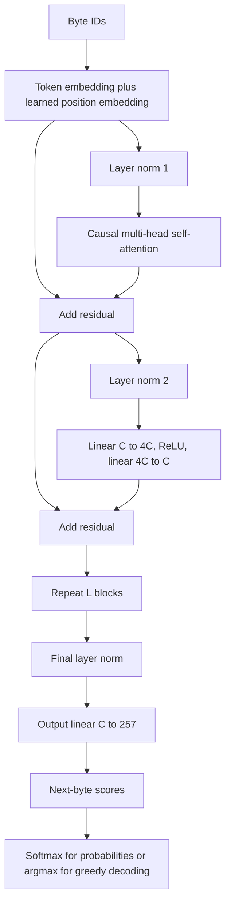
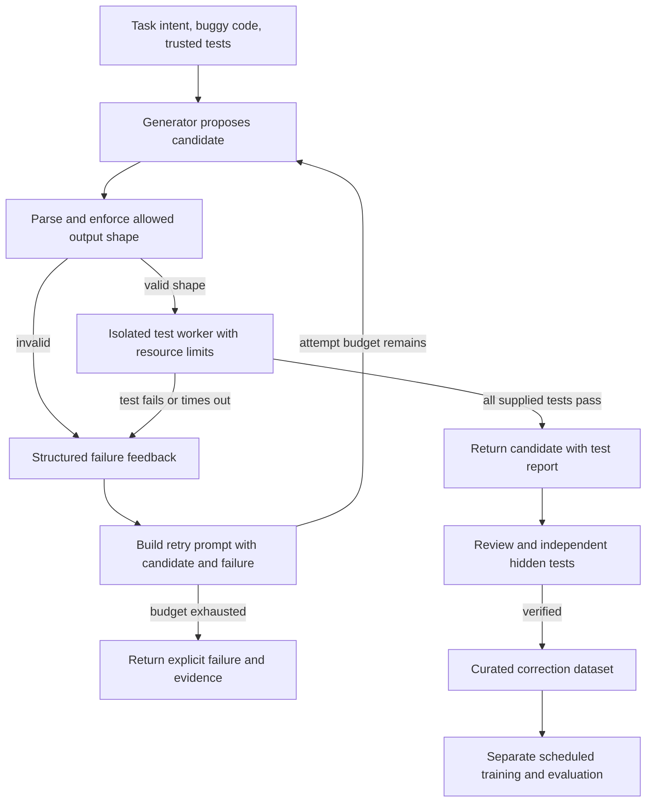

# NumPy GPT Lab: complete technical guide

Architecture, mathematics, reasoning, experiments, operations, history and proposed feedback design.

Compiled from the chapter files in docs/. Source code and preserved records are the implementation authority. This book distinguishes implemented behavior from future design. This is the sanitized public edition. Source snapshots and publication boundaries are described in records/PUBLICATION.md.

## Chapter navigation

- [1. Purpose, scope and notation](docs/01-PURPOSE.md)
- [2. Transformer architecture and forward pass](docs/02-ARCHITECTURE.md)
- [3. Softmax, loss and backpropagation](docs/03-MATHS.md)
- [4. Training objectives, optimization and persistence](docs/04-TRAINING.md)
- [5. Data, verification and measuring real progress](docs/05-DATA-EVALUATION.md)
- [6. A generator and checker: the requested feedback architecture](docs/06-FEEDBACK-DESIGN.md)
- [7. Practical operation and troubleshooting](docs/07-OPERATIONS.md)
- [8. History, versions and corrections](docs/08-HISTORY.md)
- [9. Worked examples and reading the implementation](docs/09-WORKED-EXAMPLES.md)
- [10. Limitations, verification and next experiments](docs/10-LIMITATIONS.md)
- [11. Glossary and references](docs/11-REFERENCES.md)

---

# 1. Purpose, scope and notation

## 1.1 The user's intended system

The project began as a request for a free local language-model app, then became a stricter requirement: build a GPT from random weights, with pure NumPy numerical computation, specializing in code debugging. The target machine has 16 GB RAM and an RTX 3050 Ti laptop GPU. The first supported language is Python.

Three ideas must be separated. A **model architecture** defines computations and trainable arrays. A **trained model** combines that architecture with weights obtained from data. An **application** supplies the user interface, loading, generation and any external tools. A functioning application and correct gradient code do not establish that the trained model can debug arbitrary programs.

The training task is conditional code generation. Given buggy code x, produce corrected code y. In the implemented prompt format, the byte sequence is:

```text
BUG:
<buggy Python code>
FIX:
<corrected Python code><end token>
```

The prompt contains no explicit specification or test results. A function name such as `second_distinct` hints at intent, but names do not provide a complete specification. Code that is valid for one intended behavior may be wrong for another. An advanced debugger should receive task intent and independently defined tests.

## 1.2 What "from scratch" means here

Token and position embeddings, attention projections, feed-forward matrices, normalization gains/biases and the output matrix are initialized within gpt.py. Random matrix entries use a seeded normal distribution with standard deviation 0.02. Normalization gains start at one; biases start at zero. No pretrained checkpoint is downloaded or imported.

NumPy supplies array operations, matrix multiplication, reductions, random-number generation and compressed array files. The project implements its own reverse-mode automatic differentiation over a small set of tensor operations. Thus it does not import a framework's autograd engine or optimizer.

This makes the mechanism inspectable. It does not make training fast. Standard NumPy on this setup runs on the CPU; the laptop GPU is not used by these files. A GPU backend would be an explicit change to the original constraint or require a different numerical implementation.

## 1.3 Notation

| Symbol | Meaning | Large model value |
|---|---|---:|
| B | batch size | 2 by default |
| T | actual sequence length in a forward pass | at most 384 |
| C | model width / embedding dimension | 128 |
| H | number of attention heads | 4 |
| D | width of one head, C/H | 32 |
| L | number of transformer blocks | 5 |
| V | vocabulary size | 257 |
| S | maximum learned position count / context | 384 |
| theta | all trainable parameters | 1,106,560 scalars |
| z | output logits, before softmax | B × T × V |
| p | next-token probabilities | B × T × V |
| m | answer scoring mask | B × T |
| eta | learning rate | schedule-dependent |

Vectors are treated as rows where needed to match NumPy expressions. A transpose in an attention equation affects the last two dimensions, leaving batch/head dimensions intact. A bar over an expression, such as bar(X), denotes a gradient of the scalar loss with respect to X. Natural logarithms are used for cross-entropy.

## 1.4 Bytes, characters, tokens and examples

The tokenizer maps UTF-8 bytes directly to IDs 0 through 255 and reserves ID 256 for the end of the answer. ASCII source has one byte per character, but Unicode names or comments may use multiple bytes per character. Therefore 384 tokens means 384 byte positions, not 384 Python tokens, words or Unicode characters.

One training **example** is a buggy/fixed pair. One **token position** is a next-byte prediction. One **step** updates weights from a batch. An **epoch** is approximately a pass over a dataset, but our trainers sample with replacement and do not implement a strict epoch iterator. These units cannot be substituted for one another.

For example, 80 training examples with batch 2 and 5000 steps means 10,000 sampled example draws. Uniform sampling yields roughly 125 draws per example on average, not 10,000 distinct debugging problems. Increasing draws cannot create missing task variety.

## 1.5 What a debugging model must learn

At least four capabilities are involved: generate syntactically valid Python; preserve relevant input structure; infer intended behavior; and make a change that meets that intent. The first can be helped by plain-code pretraining. The later ones need diverse tasks, specifications, tests and correction examples. A larger parameter count provides capacity, not an automatic source of those capabilities.

The original training examples are mostly short expressions with one operator changed. They do not teach package APIs, multi-file dependencies, runtime environments, asynchronous behavior or complex algorithmic repair. The app does not inspect repositories or execute suggestions.

## 1.6 Three feedback mechanisms

**Autoregressive feedback:** append a generated token to the input and predict another token. Weights remain fixed.

**Training feedback:** compare predicted probabilities with reference tokens, compute derivatives and change weights. The reference supplies a target; model confidence does not certify that target.

**External correctness feedback:** execute tests or use another independent check on a complete candidate and return concrete failures. The checker-and-retry system was discussed but is not implemented. Passing finite tests is useful evidence, not a proof for all possible inputs.


---

# 2. Transformer architecture and forward pass

## 2.1 Relating the requested diagram to the code

The original private reference image is omitted from the public edition. The independently written diagram below describes this implementation.

The supplied diagram contains the original encoder-decoder transformer layout, with orange highlighting intended to identify a GPT-style decoder. Its left stack is an encoder; the middle attention sublayer on the right reads encoder outputs. Our decoder-only model has no encoder and no encoder-to-decoder cross-attention. Each block instead has masked self-attention and a position-wise feed-forward sublayer.

The diagram says "Add & Norm" after sublayers. Our implementation uses **pre-normalization**: normalize the input to a sublayer, run it, then add the original residual stream. There is a final normalization before the output matrix. Learned position embeddings replace the sinusoidal position encoding drawn in the picture. These are deliberate implementation differences, so the picture is conceptual rather than an exact wiring diagram of gpt.py. The original transformer background is [Vaswani et al.](https://arxiv.org/abs/1706.03762); our executable details are established by the local code.



The curved residual routes carry numerical representations and gradients around sublayers. They are not independent critics and do not run a program to check its validity.

## 2.2 Embeddings

For input ID matrix I of shape B × T, token embeddings E have shape V × C and position embeddings P have shape S × C:

```text
X[b,t,:] = E[I[b,t],:] + P[t,:]
X.shape = (B,T,C)
```

The embedding vector is learned; there is no manually assigned coordinate meaning "loop" or "bug". Position vectors let the network distinguish order. Without position information, attention over a bag of tokens has insufficient information about sequence arrangement.

gpt.py uses Tensor.take for the lookups. A token can occur multiple times; backward must accumulate every occurrence into the same embedding row. Position embeddings use NumPy broadcasting across the batch, so their gradients sum over batch entries.

## 2.3 Layer normalization

For each token's C-dimensional row x, independently of other tokens and other examples:

```text
mu = (1/C) sum_i x_i
variance = (1/C) sum_i (x_i - mu)^2
xhat_i = (x_i - mu) / sqrt(variance + epsilon)
LN(x)_i = gamma_i * xhat_i + beta_i
epsilon = 1e-5
```

The code's Tensor.norm computes xhat. Multiplication by a learned gain gamma and addition of beta occur outside that operation. There are two gain/bias pairs per block plus one final pair. Unlike batch normalization, this computation does not need a running mean over previous batches. Layer normalization's background is [Ba et al.](https://arxiv.org/abs/1607.06450); the actual epsilon and placement above come from gpt.py.

Normalization manages the scale of sublayer inputs. It does not make all features identical: xhat retains relative component differences, and gamma/beta can learn feature-specific scales and offsets. Epsilon avoids division by zero for constant vectors.

## 2.4 Queries, keys and values

Let U = LN1(X). One combined projection computes:

```text
[Q | K | Vals] = U @ Wqkv + bqkv
Wqkv.shape = (C,3C)
bqkv.shape = (3C,)
```

The implementation reshapes B × T × 3C into B × T × 3 × H × D, then transposes to 3 × B × H × T × D. Selecting index 0, 1, 2 yields Q, K and Vals, each B × H × T × D.

Informally, queries describe what a position seeks, keys describe what a position offers for matching, and values carry what gets mixed into the result. These are learned linear projections; that language is an interpretation rather than a prescribed symbolic algorithm.

## 2.5 Scaled dot-product scores and causal masking

For head h and positions t and s:

```text
scores[b,h,t,s] = dot(Q[b,h,t,:], K[b,h,s,:]) / sqrt(D)
scores.shape = (B,H,T,T)
```

If independent components have roughly comparable variance, a dot product's variance grows with D. Scaling by sqrt(D) helps keep the score range from growing simply because the head is wider. It does not guarantee a particular score distribution after training.

The causal mask M is 0 for s <= t and -1e9 for s > t. Attention applies softmax along the source-position axis s:

```text
A = softmax(scores + M)
```

This prevents a position from reading future target tokens during teacher-forced training. For the sequence `a b c`, the first position can read a, the second can read a/b, and the third can read a/b/c. A position may read itself because it predicts the *next* token, not its own input token.

The implementation uses a large finite negative constant rather than negative infinity. After stable softmax, ordinary scores yield zero floating-point probability for these masked entries. With the small normal initialization, the intended masking is numerically effective; adversarially huge scores are not handled as a separate special case.

## 2.6 Attention mixture and output projection

```text
Z[b,h,t,:] = sum_s A[b,h,t,s] * Vals[b,h,s,:]
Z.shape = (B,H,T,D)
```

The heads are transposed to B × T × H × D and flattened into B × T × C. A learned projection mixes their outputs:

```text
attention_output = concat_heads(Z) @ Wo + bo
X1 = X + attention_output
Wo.shape = (C,C)
```

All heads attend over the sequence, but their projections differ. Head count changes how C is partitioned, not the total Q/K/V matrix sizes for fixed C. More heads therefore do not multiply parameter count in this implementation. They do affect the B × H × T × T score tensor.

## 2.7 Feed-forward sublayer

```text
U2 = LN2(X1)
F = ReLU(U2 @ Wup + bup)
X2 = X1 + F @ Wdown + bdown
Wup.shape = (C,4C)
Wdown.shape = (4C,C)
```

ReLU(a) = max(0,a). This provides a nonlinearity; otherwise successive linear transforms could collapse into a single linear transform in isolation. Unlike attention, this sublayer does not directly mix different sequence positions. Attention has already mixed their information into the vectors it receives.

The project uses ReLU for simplicity, not GELU or a gated feed-forward activation. Dropout is not present. There is no mixture-of-experts routing. These details matter when comparing our parameter counts or behavior with another "GPT" implementation.

## 2.8 Repetition and output head

The block repeats L times. Then:

```text
hidden = LNfinal(X_L)
logits = hidden @ Wout
Wout.shape = (C,V)
logits.shape = (B,T,V)
```

There is no output bias, and Wout is not tied to the token embedding E. Different positions receive a full vector of 257 logits. During training all scored positions contribute to loss in parallel. During generation only the final position's logits choose the next byte.

Softmax is inside attention and inside loss/sampling computations. Greedy generation directly takes argmax of logits: softmax preserves their ordering, so applying softmax first would not change that selection.

## 2.9 Exact parameter count

Embeddings contribute VC + SC. A block contributes:

| Arrays | Count |
|---|---:|
| QKV matrix and bias | 3C² + 3C |
| Attention output matrix and bias | C² + C |
| Feed-forward up matrix and bias | 4C² + 4C |
| Feed-forward down matrix and bias | 4C² + C |
| Two norm gains and two norm biases | 4C |
| **Per block** | **12C² + 13C** |

The final norm contributes 2C; output head contributes CV. Therefore:

```text
N = (2V + S + 2)C + L(12C² + 13C)
```

With V=257, S=384, C=128 and L=5:

```text
embedding + position + output + final norm = 900 * 128 = 115,200
one block = 12*16,384 + 13*128 = 198,272
five blocks = 991,360
total = 1,106,560
```

Other recovered configurations are 90,528 parameters for C=48/S=192/L=2, 207,552 for C=64/S=384/L=3, 17,680 for C=16/S=384/L=1 and 14,608 for C=16/S=192/L=1. These numbers count learned scalars, not Adam buffers or activations.

## 2.10 Runtime and memory

Per block the dense projections and feed-forward network cost roughly O(BTC²), while attention matrix products cost O(BT²C). Scores/probabilities use O(BHT²) storage. Backpropagation retains more arrays than inference.

A 1,106,560-element float64 weight set occupies 8,852,480 bytes, about 8.44 MiB. Weights, gradients and two Adam buffers alone use about 33.8 MiB. Temporary arrays, graph objects, attention activations, copies and BLAS workspaces increase actual process memory substantially. That lower bound is not an exact RAM estimate.

At B=2, H=4, T=384 one attention score tensor has 1,179,648 float64 entries, exactly 9 MiB. Several such arrays can coexist per layer during training. Doubling context makes these tensors four times as large. Reducing width primarily helps dense-matrix work; reducing context directly helps attention memory. This is why a longer input limit is not a free configuration change.


---

# 3. Softmax, loss and backpropagation

This chapter derives the equations implemented in gpt.py. It is intended to make the training mechanism auditable, including the operations usually hidden by an automatic-differentiation framework.

## 3.1 From scores to probabilities

For a vector of logits z with V components:

```text
p_i = exp(z_i) / sum_j exp(z_j)
```

Every probability is nonnegative and their sum is one, up to floating-point rounding. Larger scores mean larger probabilities. The scores themselves need not sum to one, need not be positive and are not percentages.

For numerical stability, let a = max(z):

```text
p_i = exp(z_i-a) / sum_j exp(z_j-a)
```

Multiplying numerator and denominator by exp(-a) leaves the mathematical result unchanged. Now the largest exponent is zero, whose exponential is one, avoiding overflow from a very large positive logit. Very negative relative scores can underflow to zero, which is generally acceptable for probabilities but is why loss uses log probabilities directly.

Example:

```text
z = [2,1,0]
z-max(z) = [0,-1,-2]
exp(.) = [1,0.367879,0.135335]
sum = 1.503214
p = [0.665241,0.244728,0.090031]
```

This is a distribution over three hypothetical candidates. The actual model has 257 candidates. A candidate with probability 0.665 is not "66.5% certain to fix the whole function". It is a probability assigned to one next byte under the model. Those are different events.

## 3.2 Log-softmax and cross-entropy

Define logsumexp(z) = log(sum_j exp(z_j)). A stable form is:

```text
logsumexp(z) = a + log(sum_j exp(z_j-a))
log p_i = (z_i-a) - log(sum_j exp(z_j-a))
```

For a known correct next token k, the negative log-likelihood is:

```text
loss = -log p_k
```

Using the previous distribution, the first candidate yields approximately 0.407606 nats of loss, the second 1.407606, and the third 2.407606. Increasing the correct token's probability lowers loss. Assigning zero probability would give infinite mathematical loss; stable log-softmax avoids explicitly taking log of an underflowed zero probability.

For sequence and batch positions indexed collectively by r, answer mask m_r and N = sum_r m_r:

```text
L = -(1/N) sum_r m_r * log p[r,target_r]
```

The code uses max(N,1) as a defensive denominator. Data preparation normally ensures scored targets exist. Positions with mask zero contribute neither loss nor gradient. The mask is a **loss mask**, distinct from the **causal attention mask**. Loss masking chooses what we optimize; causal masking chooses what each position is allowed to read.

Pretraining masks every position with one. Debugging fine-tuning masks the prompt positions with zero and the answer/EOS positions with one. The prompt still influences gradients through attention and embeddings; not scoring prompt predictions does not prevent learning representations of prompt tokens.

## 3.3 Deriving the softmax derivative

Let Z = sum_j exp(z_j), so p_i = exp(z_i)/Z. Quotient differentiation gives:

```text
∂p_i/∂z_j = p_i(δ_ij - p_j)
```

Here δ_ij is one when i=j and zero otherwise. Increasing a score increases its own probability but decreases others because the distribution must still sum to one.

If a later computation supplies gradient g_i = ∂L/∂p_i, then:

```text
∂L/∂z_j = sum_i g_i p_i(δ_ij-p_j)
          = p_j [g_j - sum_i g_i p_i]
```

Tensor.softmax uses exactly this vector-Jacobian product:

```python
p * (g - (g * p).sum(axis=-1, keepdims=True))
```

It does not construct the full V × V Jacobian for every row, avoiding unnecessary memory. In attention the row length is T rather than V, but the derivative is the same operation along the source-position axis.

## 3.4 Why cross-entropy produces p minus target

For one-hot target y, where y_k=1 and all other components are zero:

```text
L = -sum_i y_i log p_i
  = -sum_i y_i z_i + logsumexp(z)  because sum_i y_i = 1
∂L/∂z_j = p_j - y_j
```

With masking and averaging, the gradient is (p_j-y_j)*m_r/N. In cross_entropy.backward, the code computes exp(logp), subtracts one at the target index, multiplies by the mask/denominator and reshapes to B × T × 257.

Example with the third candidate correct:

```text
p = [0.665241,0.244728,0.090031]
y = [0,0,1]
gradient = [0.665241,0.244728,-0.909969]
```

A direct gradient-descent update z <- z - eta*gradient lowers the first two logits and raises the third. In the real model z is not a free stored parameter: the chain rule propagates this signal back through the output matrix, hidden states, blocks and embeddings.

Thus softmax itself does not look at a solution and decide whether it is correct. The reference target defines the loss. A probability distribution plus no external target is not a correctness oracle.

## 3.5 Chain rule and reverse-mode differentiation

If a scalar loss depends on a via b=f(a) and c=g(b), then:

```text
∂L/∂a = (∂L/∂c)(∂c/∂b)(∂b/∂a)
```

For arrays this becomes a sequence of vector-Jacobian products. Reverse mode is efficient for many parameters and one scalar loss because one backward traversal accumulates derivatives for all relevant parameters.

Each Tensor stores its data, gradient, parent nodes and a backward closure. Tensor.backward performs a depth-first traversal, records a topological order, seeds the scalar loss with gradient one, and invokes closures in reverse order. Shared nodes appear once in the traversal, but every incoming path adds its contribution into the same gradient array.

Persistent parameter tensors have gradients reset by model.zero_grad before a new training backward pass. Temporary graph tensors start with zero gradients when constructed. The engine is minimal: calling backward repeatedly on the same graph without resetting all internal gradients is not a supported training pattern. It has no no-grad context, graph compilation, higher-order differentiation, or automatic memory planning.

## 3.6 Addition and broadcasting

For C=A+B, each input receives the output gradient, adjusted for any broadcasting. If a bias b with shape C is added to X with shape B × T × C, then:

```text
bar(X)[b,t,c] += bar(C)[b,t,c]
bar(b)[c] += sum_b sum_t bar(C)[b,t,c]
```

unbroadcast first sums away extra leading dimensions, then sums axes where the original input size was one. Without these reductions, gradients for shared biases or position embeddings would have the wrong shape or silently wrong values.

For element-wise multiplication C=A*B:

```text
bar(A) += unbroadcast(bar(C)*B, A.shape)
bar(B) += unbroadcast(bar(C)*A, B.shape)
```

Layer-normalization gains use this multiplication rule. The gradient for gamma sums over every batch/token position where that component was used.

## 3.7 Matrix multiplication

For Y=XW with row-vector convention:

```text
bar(X) = bar(Y) W^T
bar(W) = X^T bar(Y)
```

The code swaps the final two axes to transpose batched matrices. A weight W shared across batch/token dimensions requires summing contributions from those dimensions, performed by unbroadcast after NumPy's broadcasted matmul.

For an attention product QK^T the same rule gives:

```text
bar(Q) = bar(scores) K / sqrt(D)
bar(K) = bar(scores)^T Q / sqrt(D)
```

For Z=AVals:

```text
bar(A) = bar(Z) Vals^T
bar(Vals) = A^T bar(Z)
```

The attention softmax rule links bar(A) back to bar(scores). The causal mask is a constant, so it receives an unused gradient in this minimal engine but is never optimized. Masked future scores have effectively zero softmax derivative in the normal numerical regime.

## 3.8 ReLU

```text
y_i = max(0,x_i)
bar(x_i) = bar(y_i) if x_i>0 else 0
```

At exactly zero the mathematical derivative is not unique; this implementation chooses zero. Negative units therefore do not receive a gradient through that ReLU on that example. This is one reason initialization and learning-rate scale can affect training dynamics.

## 3.9 Layer-normalization derivative

Let u=x-mean(x), r=1/sqrt(mean(u²)+epsilon), and h=u*r. Suppose g is the upstream gradient for h after the learned gain has been accounted for. For a row with C entries:

```text
bar(x) = r * [g - mean(g) - h*mean(g*h)]
```

Why these terms? The direct scaling route contributes r*g. Dependence of the row mean subtracts the mean gradient. Dependence of variance subtracts the component correlated with normalized activations. The epsilon-adjusted inverse standard deviation r is used consistently in both forward and backward.

The separately learned affine parameters have:

```text
bar(gamma) = sum_positions upstream * h
bar(beta) = sum_positions upstream
```

The compact Tensor.norm closure implements the normalization derivative; generic multiply/add closures implement gamma/beta gradients. This division keeps the normalization operation reusable.

## 3.10 Reshape, transpose and lookup

A reshape changes indexing without changing which mathematical elements are represented. Its backward reshapes the gradient to the input shape. A transpose permutes axes; backward applies the inverse permutation. These rules are crucial for separating and recombining attention heads.

For lookup Y=E[indices], backward scatter-adds each output gradient into the selected input row. Repeated indices must accumulate. `np.add.at` handles repeated-index accumulation; a naive indexed `+=` can mishandle repeated indices because advanced indexing may use buffered copies.

The same `take` method also selects Q/K/V slices from the leading dimension of the reshaped combined projection. It therefore works for both embedding tables and attention tensor selection.

## 3.11 Residual gradients

For Y=X+F(X):

```text
bar(X) = bar(Y) + J_F(X)^T bar(Y)
```

The identity route provides a direct path for information and derivatives through a block, in addition to the learned transformation route. This can help optimization; it does not mean gradients are guaranteed healthy at arbitrary depth. Again, this "feedback" is a derivative path, not a behavioral checker.

## 3.12 Gradient checking

For a normalized random direction d in a parameter array theta and small epsilon:

```text
directional finite difference = [L(theta+epsilon*d)-L(theta-epsilon*d)]/(2*epsilon)
analytic directional derivative = sum_i gradient_i*d_i
```

The test compares these values for every parameter family at float64 precision, using epsilon=1e-5 and absolute tolerance 2e-5 on a tiny model. This covers embeddings, normalization, attention matrices, feed-forward matrices and the output projection. It is stronger than merely checking that training loss falls, because a flawed derivative can sometimes still reduce a simple loss.

Nevertheless one random direction per family is not a formal proof for all shapes and inputs. ReLU nondifferentiability near zero can complicate finite differences. The implementation tests use a fixed seed and small nonpathological inputs. There is also a causality test: changing future tokens must not alter earlier logits.

## 3.13 Temperature and decoding

For positive temperature tau, sample from softmax(z/tau). As tau decreases the distribution concentrates on top scores; as tau increases it spreads. Greedy decoding instead selects argmax(z), deterministically for a fixed model/input, with NumPy's tie behavior.

There is no top-k, nucleus/top-p, beam search or correctness-aware decoding here. The app uses greedy decoding. Repeated nonsense in screenshots therefore cannot be attributed simply to high sampling temperature. More sophisticated sampling changes the search distribution, not the underlying learned competence.

## 3.14 Entropy, perplexity and confidence

Entropy H(p)=-sum_i p_i log p_i measures spread in a distribution. Cross-entropy against reference tokens measures assigned probability to observed targets. Perplexity exp(L) expresses average uncertainty on that tokenization. With byte tokens these values are not directly comparable to a subword model's token perplexity.

Uniform output over 257 symbols has loss log(257), about 5.549076 nats. The smoke runs near 5.55 are consistent with near-random prediction. A loss around 2.49 corresponds to byte perplexity around 12.1, but says nothing by itself about semantic correctness of an entire fix. A low-entropy wrong answer can be confidently invalid or behaviorally wrong.


---

# 4. Training objectives, optimization and persistence

## 4.1 What learning changes

At inference, weights are fixed and a forward pass produces logits. During training, weights change to reduce a target-defined scalar loss. Training does not attach a verbal explanation to each neuron or store each correction in a searchable dictionary. Information is distributed across numerical parameters, and the resulting behavior must be evaluated empirically.

The same transformer can be trained with different objectives. This project first tried supervised buggy-to-fixed generation alone, then added plain-Python next-byte pretraining followed by debugging fine-tuning. Pretraining supplies more syntax/idiom exposure; fine-tuning teaches the conditional prompt format and repair behavior. Neither stage guarantees the other capability.

## 4.2 Plain-Python pretraining

pipeline_train.py reads a training byte stream and a separate validation stream. For context T, it chooses start offsets uniformly with replacement and takes T+1 bytes. Inputs are the first T bytes; targets are the following T bytes:

```text
stream:   d e f   f ( x ) ...
input:    d e f   f ( x ...
target:   e f   f ( x ) ...
```

Every target position is scored. The causal mask ensures a prediction cannot read its target from a future input position. Random windows may begin inside a line or function; the model learns local continuations without being told every window begins a complete module. The corpus concatenates files with newlines, without a distinct document-boundary token. Windows can cross those boundaries. That is a known simplification.

EOS ID 256 is not present in ordinary byte streams. Pretraining therefore does not teach it as an end-of-document marker; debugging fine-tuning introduces EOS at the end of reference answers. This stage mismatch is small and intentional, but worth remembering when interpreting a pretrained model's output behavior.

The default pipeline B=2, T=384, steps=5000 predicts 3,840,000 sampled training token positions. The corpus holds 8,846,516 training bytes. Sampling with replacement means overlap and repeats are expected; "5000 steps" does not mean a complete pass over all source bytes.

## 4.3 Supervised debugging and teacher forcing

train.encode serializes prompt bytes and fixed-answer bytes plus EOS. Let prompt length be P and answer-plus-EOS length be A. The full sequence length is P+A, while x and y each have length P+A-1. The first answer byte is predicted from the final prompt byte at input position P-1.

```text
x = full_sequence[:-1]
y = full_sequence[1:]
mask[P-1 : P+A-1] = 1
```

The correct answer prefix is visible during training. This is teacher forcing: at the position predicting answer byte j, the network sees earlier *reference* bytes, not earlier generated mistakes. At inference it sees its own chosen bytes. That train/inference difference, sometimes called exposure bias, can cause a small error to lead into an unfamiliar continuation and compound.

The loss mask excludes prompt predictions but does not remove the prompt from attention. It also excludes padding. The trainer trims trailing unused positions from each batch up to the last scored target. Earlier scored positions cannot read later padding because attention is causal.

If prompt plus answer exceeds the checkpoint's context, encode raises an error. It does not silently truncate the reference. The app checks only whether the prompt itself fits; during generation it keeps the last context positions once full. Thus training has a stricter combined example-size requirement than the app's initial-input check.

## 4.4 Batch loss, sampling and noisy curves

Training batches are sampled with replacement. A batch of two long loop examples may be harder than the previous batch of two one-line arithmetic examples. Therefore training loss can rise from one evaluation point to another while general training progress continues.

A reported training loss is for the current batch, not a smoothed full-dataset loss. Validation in the pipeline is more comparable over time: pretraining uses eight fixed sampled batches from a fixed RNG seed; debugging uses all validation examples packed into batches. Their losses are weighted by scored token counts, not a simple average that gives a short answer the same weight as a much longer one.

The legacy train.py instead averages per-example validation losses equally. This difference is another reason not to compare every old logged number as though it used the same measurement procedure.

## 4.5 Global gradient clipping

Collect all parameter gradients into a conceptual vector g:

```text
norm = sqrt(sum_over_arrays sum_elements gradient^2)
scale = min(1, 1/max(norm,1e-12))
clipped_gradient = scale * gradient
```

The threshold is one. Scaling all arrays by the same factor preserves gradient direction while bounding its Euclidean magnitude. Clipping can limit extreme updates from outlier batches, but it does not guarantee convergence, repair incorrect gradients, or replace an appropriate learning rate.

The pipeline explicitly rejects nonfinite loss or gradient norm. If numerical failure occurs, the finally block attempts to save last state and export best weights. A filesystem error during saving is still possible; there is no transactional checkpoint system.

## 4.6 Adam

The optimizer tracks two exponentially smoothed arrays for each parameter: first moment m and second raw moment v. At step t with clipped gradient g_t:

```text
m_t = beta1*m_(t-1) + (1-beta1)*g_t
v_t = beta2*v_(t-1) + (1-beta2)*g_t^2
mhat_t = m_t / (1-beta1^t)
vhat_t = v_t / (1-beta2^t)
theta_t = theta_(t-1) - eta_t*mhat_t/(sqrt(vhat_t)+epsilon_adam)
beta1=0.9, beta2=0.999, epsilon_adam=1e-8
```

Initialization at zero biases early moments toward zero; the division by 1-beta^t corrects that under the standard moment interpretation. The square is element-wise. Different parameters receive different normalization from their gradient history. Adam is described by [Kingma and Ba](https://arxiv.org/abs/1412.6980); the constants and code paths here are our implementation.

Adam's momentum is not a memory of which answer was correct. It stores numerical summaries of gradient history. Restoring weights without m/v changes subsequent optimization even if the next batch is the same.

## 4.7 AdamW and weight decay

The new pipeline adds decoupled decay before the adaptive update:

```text
theta <- (1-eta_t*lambda)*theta
theta <- theta - eta_t*mhat/(sqrt(vhat)+epsilon_adam)
```

Default lambda is 0.01. In this implementation only matrix parameters with at least two dimensions are decayed, excluding `token` and `position`. Biases and normalization gains are not decayed. The exact exclusion policy is an implementation choice, not an intrinsic law of AdamW.

Adding lambda*theta to the gradient before Adam is not generally equivalent, because Adam's adaptive scaling would also act on that term. This distinction motivates decoupled decay; background is [Loshchilov and Hutter](https://arxiv.org/abs/1711.05101).

Weight decay can discourage unconstrained parameter growth and sometimes improve generalization. With 80 examples it cannot create missing information about unseen bug families. Dropout was discussed as another regularizer but is absent from all captured numerical code.

## 4.8 Warmup and cosine decay

For a run with R requested steps, pipeline warmup factor and decay are:

```text
warmup(t) = min(1, t/min(100,R))
decay(t) = 0.1 + 0.45*[1+cos(pi*t/R)]
eta_t = base_lr * warmup(t) * decay(t)
```

The decay factor begins near one and ends at 0.1. It is multiplied by warmup rather than beginning only after warmup completes. Thus early learning rates reflect both factors. The legacy trainer uses the same-shaped decay but warmup min(50,R), and its default base rate is 0.001 instead of the pipeline's 0.0003.

Fine-tuning instructions lower the base rate to 0.0001. That is a conservative choice to adapt pretrained weights, not a measured optimum. The run metadata records actual arguments so future comparisons can distinguish changed data from changed optimization settings.

## 4.9 Best-checkpoint saving and early stopping

Before any update, the pipeline evaluates validation loss and saves step zero as the initial best. At each evaluation it considers a score improved only if it is at least 1e-5 lower than the previous best. On improvement, best state is saved and the non-improvement counter resets. Otherwise the counter increments. At the default patience eight, eight consecutive non-improving evaluations stop training.

Validation is measured every 50 steps by default and on the final requested step. This means patience is measured in **evaluations**, not examples or raw steps. An improvement at step 250 followed by worse performance at step 300 need not stop training; later recovery is allowed. The actual captured pretraining history demonstrates that: validation rose slightly at 300 then improved at 350 and 400.

Early stopping minimizes a particular validation metric. It does not guarantee best behavioral repair accuracy, and repeatedly tuning on the same validation data can overfit the evaluation procedure. A separate final test set remains necessary.

## 4.10 File formats and exact state

GPT.save produces an NPZ with parameter arrays and a config vector ordered as width, context, heads, layers, seed. GPT.load reads these without pickle. The pipeline optimizer checkpoints additionally contain step and keys `adam_m.<parameter>` / `adam_v.<parameter>`. Config order relies on the dictionary insertion order in GPT.__init__; changing it would require a format migration.

The new pipeline writes:

| Suffix | Meaning |
|---|---|
| requested `.npz` | Exported best weights only |
| `.best.npz` | Best weights with Adam arrays and its step |
| `.last.npz` | Most recent weights with Adam arrays and reported step |
| `.history.jsonl` | Initial validation plus evaluation rows |
| `.run.json` | Stage, arguments, config, data hashes and optional init hash |

The final requested .npz lacks a step key, even though its values came from the best checkpoint. It is not evidence that the run had zero steps. Use the associated best/history files to find the selected step.

The archive found `python-base.best.npz` at step 400 and `python-base.last.npz` at step 422. Best validation loss at the last recorded evaluation is 2.4919140802352753. The final weights-only export matches the best checkpoint's arrays. This is partially completed pretraining, not evidence of a new debugging fine-tune or a general debugging ability.

## 4.11 Pause, resume and interruption limits

Ctrl+C raises KeyboardInterrupt. The pipeline catches it, saves last state in finally, then loads best weights and exports the requested output. It must finish saving before the terminal is closed. Killing the process or powering off skips that Python cleanup.

**Legacy train.py --resume:** restores stored weights, m/v and step if present. It resets the run's random generator and local learning-rate schedule, so it is not bit-for-bit continuation. A weight-only checkpoint starts fresh optimizer state.

**pipeline_train.py --init:** restores weights only. It starts new m/v, step count, RNG and schedule. This is appropriate when changing objectives between pretraining and fine-tuning. It is also a way to continue learning from paused weights, but is not exact optimizer resume. Use a new output name because the pipeline refuses existing outputs.

There is a further subtlety: Ctrl+C may interrupt inside a parameter update. The saved `step` variable is set before the entire iteration completes, so last state could contain a partially applied step. Neither trainer saves an atomic before/after transaction for every update. Best checkpoints written after evaluation are a safer consistently evaluated point, though writes themselves are not atomic. A stronger continuation design would save RNG state, absolute schedule state, best score, patience, dataset fingerprints, optimizer arrays and a completed-step counter, writing to a temporary file then atomically replacing a checkpoint.

## 4.12 Reproducibility boundaries

Seeds fix initialization and sampling logic within a given implementation. Different NumPy versions, CPU BLAS libraries or threading may still lead to floating-point differences. The archive stores source/data hashes and records the local verification environment, but the original requirements file allows a range of NumPy versions. Historical runs without a metadata file cannot be reconstructed exactly from final weights alone.

The pretraining validator samples only eight fixed batches, about 6144 token positions at defaults, from a million-byte validation corpus. That makes comparisons stable but only approximately representative. More validation windows and file-family grouping would strengthen the measurement at extra compute cost.


---

# 5. Data, verification and measuring real progress

## 5.1 The original sixteen pairs

examples.jsonl contains short buggy/fixed Python snippets for arithmetic, list indexing, simple predicates and related one-line repairs. There are 16 rows. The first trainer randomly held out roughly one fifth of rows, leaving 13 for training and 3 for validation. It was a mechanical demonstration of a training loop, not a sufficient language-learning corpus.

A model exposed only to those pairs is trying to learn Python syntax, prompt formatting, variable naming, copying and bug repair simultaneously from very few tokens. Even successfully reproducing those answers would establish memorization or narrow pattern learning, not arbitrary debugging.

## 5.2 The 640-row dataset and why its size was misleading

make_data.py defines 16 templates and generates 40 function-name variants of each. The variants preserve the same parameter names, body and repair, changing names such as `factorial_12`. There are 640 rows but still only 16 underlying exercises. The archive retains all of them rather than retroactively relabeling the old experiment as broader data.

The upgraded legacy trainer sorts family labels, shuffles them with NumPy seed 123, then holds out max(1, floor(family_count/5)) families. For advanced.jsonl the held-out families are contains, last and multiply. The result is 520 training pairs and 120 validation pairs.

Factorial is in the training split for that dataset. The earlier speculation that it might have been held out was resolved by reproducing the split. A screenshot of a malformed factorial suggestion therefore demonstrates a failure even on an underlying familiar template, assuming the app loaded the intended large checkpoint. The screenshot itself does not prove which filename was loaded because the original GUI does not display checkpoint identity.

## 5.3 The 100 different exercises

make_distinct.py replaces pure renaming with different short tasks. Categories and counts:

| Family | Tasks |
|---|---:|
| Arithmetic | 20 |
| Predicates | 15 |
| Sequences | 15 |
| Strings | 15 |
| Filtering | 10 |
| Maps and sets | 10 |
| Loops | 10 |
| Boundary cases | 5 |

The detailed catalog is DISTINCT_PROBLEMS.md. Each task has at least two explicit cases. Fixed functions must return expected outputs on all of them. The intentionally buggy version must give a different result or throw an exception on at least one. All code executed by this generator is source-controlled template code, not arbitrary imported user snippets.

The current split holds out the arithmetic family: 80 tasks train, 20 validate. That is a deliberately difficult family-transfer split. It may be less representative of the same-family repairs a user first tries, but it avoids some superficial template leakage. Some concepts still overlap, such as multiply as arithmetic and product as a loop, so it does not ensure complete conceptual separation.

"Distinct" is a practical description of different exercises, not a formal count of independent bug mechanisms. Positive/negative predicates and inclusive/exclusive comparisons share underlying operations. This is more useful variety than renamed duplicates but still small for training language competence from scratch.

## 5.4 Parameter count versus data count

1,106,560 / 80 = 13,832 parameters per training example. This ratio illustrates how little task variety there is, but it is not a universal overfitting threshold. Examples differ in length, redundancy and information content; architectures and training methods differ. There is no rule that one example supports a fixed number of parameters.

A better report includes unique tasks, distinct bug families, scored tokens, source diversity, exact/near duplicates, repeated exposures, held-out repair accuracy, and confidence intervals. A larger model can memorize a small dataset, but the observed malformed outputs show that even perfect memorization was not established for this project.

## 5.5 Preparing a local Python corpus

prepare_pipeline.py finds the installed interpreter's standard-library source directory using sysconfig. It scans .py files, excludes site-packages, tests/test, idlelib, ensurepip and caches, and skips files over 500,000 bytes. It reads with Python's tokenize.open to honor encoding declarations, parses the text with ast.parse and skips invalid/undecodable sources. It does not import or execute corpus modules.

Each accepted text is encoded as UTF-8 and exact duplicate normalized byte contents are removed by SHA-256. For deterministic whole-file splitting, the relative file path is hashed; a modulus rule assigns roughly 10% of files to validation. A file remains entirely in one split. The concatenated bytes plus separating newlines are saved in separate .bin files.

The captured corpus has 560 files, 8,846,516 training bytes and 1,008,619 validation bytes. A sources.json manifest records source paths, original byte hashes, assigned split and normalized UTF-8 size. The installed Python license is copied to PYTHON-LICENSE.txt; comments in the corpus retain applicable source notices. This is a local source archive, not a download of The Stack, CodeSearchNet or arbitrary GitHub repositories. Those sources were discussed but not ingested.

File-based splitting does not eliminate duplication across sibling modules, copied idioms or repeated license headers. Content normalization/near-duplicate filtering and package-level splits could improve it. Very common boilerplate can lower next-byte loss without much debugging benefit. The file path hash is reproducible under the same path names and content collection rules, not a semantic independence guarantee.

## 5.6 Verified synthetic mutation pipeline

The mutation generator begins with fixed functions from the source-controlled 100 exercises. It collects AST operators and swaps selected kinds, for example addition/subtraction, true/floor division, equality/inequality, strict/non-strict comparisons, membership/non-membership and Boolean and/or. It also retains the original deliberately buggy version.

For each candidate:

1. Parse/construct candidate Python from the trusted template.
2. Define the candidate in an isolated Python namespace within the generator process.
3. Run the task's known input/output cases.
4. Retain the candidate only if at least one case fails or raises an exception.
5. Deduplicate exact buggy/fixed pairs.
6. Require the serialized pair to fit the 384-byte training context.
7. Assign all related mutations to the same family split.

The result is 162 verified pairs, not tens of thousands. The generation stage does not magically create new task specifications. A candidate's failure establishes that a particular mutation is caught by at least one finite case; it does not establish that the fixed reference is universally correct.

These executions are safe only under the narrow assumption that our own short templates and allowed mutations remain understood and finite. They run in-process and are not a security sandbox. This script must not be adapted to execute untrusted downloaded code simply by removing that restriction. A timeout on a subprocess alone would also not constitute security isolation.

AST operator objects can be shared by Python's parsed tree representation. The mutation code locates the target node by identity; a copied shared operator can affect more than one occurrence. Every retained result still undergoes tests, but we should not claim every mutation is exactly one isolated textual edit. That is a useful future refinement for cleaner causal experiments.

## 5.7 Splitting before augmentation

If one task's original function is in training and its mutated/renamed counterpart is in validation, the apparent validation improvement can come from nearly identical patterns. Splitting by family before assigning mutations keeps those near relatives together. The pipeline explicitly rejects overlapping family labels between debugging training and validation files.

That guard checks labels, not arbitrary semantic code similarity. A mislabeled duplicate could pass it. A robust pipeline should canonicalize ASTs, strip irrelevant identifiers where appropriate, compare normalized source, trace repository ancestry, and separate related tasks before any augmentation. A final benchmark should also avoid examples included in pretraining when possible or disclose such overlap.

## 5.8 Loss, syntax, exact match and behavior

Each metric answers a different question:

| Metric | Evidence it supplies | What it misses |
|---|---|---|
| Teacher-forced byte loss | Probability assigned to reference continuations | Whether free generation succeeds |
| Python parsing | Output conforms to Python grammar | Runtime behavior, intent, safety |
| Presence of a top-level function | A minimal expected output shape | Whether it is the requested function |
| Exact reference match | Reproduction of one chosen target | Alternative correct repairs |
| Passing fixed tests | Correct results on tested cases | Untested inputs and hidden side effects |
| Independent hidden tests | Stronger evidence on unseen cases | Still not a universal proof |

evaluate.py uses the existing generator and reports parsing plus exact-match counts. It never executes the generated output. A function with an unrelated extra expression could pass its shape check; a correct alternate implementation could fail exact matching. That evaluator is a diagnostic, not a semantic benchmark.

The app's AST check similarly asks whether any top-level FunctionDef or AsyncFunctionDef exists after parsing. It does not validate the requested name, signature, return behavior or absence of additional code. Its label explicitly says parsing is not correctness.

## 5.9 Example ambiguity and domain contracts

`second_largest([2,7,7,4])` can reasonably mean 7 if duplicates count, or 4 if "distinct" is required. Without intent in the prompt, the model cannot infer a uniquely correct repair from code alone. The corresponding exercise assumes at least two distinct elements.

Other contracts matter too: ordinary average assumes a nonempty list; first/last assume nonempty input; divide assumes nonzero denominator. Separate safe variants cover empty/zero cases. A fix should not silently impose a new contract unless the task calls for it. Future data should include a task description and tests as explicit prompt fields, and generation must use precisely that same format.

## 5.10 Statistical uncertainty

With n independent tasks and k successes, an observed success rate k/n is only an estimate. A rough binomial standard error is sqrt(p*(1-p)/n), though this normal approximation behaves poorly near zero/one and for tiny samples. With n=20 and p=0.5 it is about 0.112, meaning substantial uncertainty. Exact or Wilson intervals are better for reporting small counts.

Mutated siblings are correlated, so treating 162 pairs as 162 independent task draws can underestimate uncertainty. Report both task-level and mutation-level outcomes, and bootstrap by task/family rather than blindly by row if estimating intervals.

Validation used to choose a checkpoint is no longer an untouched final test. Keep a final set with separately written requirements, unseen families or independently sourced tasks, and frozen tests. Do not repeatedly add failed benchmark examples to training while continuing to call that benchmark unseen.

## 5.11 What the current evidence actually says

Gradient, causality, serialization, learning and pipeline-control tests pass. The original app screenshots show malformed output on factorial and an unseen second-distinct task. The captured plain-Python pretraining loss fell from approximately uniform prediction to 2.4919 on its sampled validation windows by step 400. That is evidence of improved byte modeling on this corpus, not evidence that the model now repairs code correctly.

There is no saved independent behavioral benchmark showing general debugging success. The next meaningful experiment is to complete/revisit pretraining, fine-tune with a documented split, and assess generated repairs on independent tasks using safe behavior checks. Increasing parameter count or adding more renamed rows alone cannot substitute for that evidence.


---

# 6. A generator and checker: the requested feedback architecture

## 6.1 Implementation status

The user proposed two units: a "brain" that solves the problem and another unit that checks the result against learned information to minimize error. The core idea is useful, but the checker must be specified carefully. The captured app generates once and checks whether the result parses as a Python function. It does not run tests, retry after errors, or update weights from interaction.

This chapter specifies a future design. It does not claim that drawing the diagram or writing these requirements has implemented that system.

## 6.2 Why a second model is not automatically an independent checker

If the same small model generates an answer and then rates its own answer, both judgments can share the same blind spots. A second model trained on the same narrow data may do the same. Agreement is not sufficient evidence of correctness. A learned critic could be useful later, but independent executable tests give more concrete feedback for code.

A valid checker needs an oracle: known expected outputs, task invariants, reference behavior, formal specifications or trusted human judgment. A model's high next-token probability is not that oracle. Python parsing is a useful first filter but cannot decide whether `a-b` should have been `a+b`.

## 6.3 Proposed end-to-end flow



A successful result should be described as "passed these tests" rather than "proved correct". The system must expose failures instead of hiding an invalid suggestion behind a success label.

## 6.4 Responsibilities and boundaries

**Generator:** receives the task and bounded context, returns a candidate function. It cannot authorize its own execution policy, overwrite tests, or claim success by printing a phrase.

**Checker/controller:** owns the test cases, output schema, retry count, resource budget and decision rule. It validates the candidate's expected function name/signature and rejects extra executable top-level content before any execution.

**Execution worker:** runs inside an actual isolation boundary with restricted filesystem/network/process capabilities, timeouts and resource quotas. The controller remains outside. Arbitrary Python can access powerful features, so a simple `exec` with a reduced builtins dictionary is not a general security solution. A subprocess with a timeout controls time but not filesystem/network access. The current source-controlled mutation checks are not an implementation of this worker.

**Training process:** consumes reviewed examples offline and updates a new checkpoint, leaving the old model available for comparison/rollback. The interactive generator should not mutate its parameters while a user is testing an answer.

## 6.5 Structured feedback format

A future retry example could contain fields like:

```text
TASK:
Return n factorial for a nonnegative integer n.
BUG:
def factorial(n): ...
ATTEMPT:
def factorial(n): ...
CHECK:
case: factorial(5)
expected: 120
observed: 24
FIX:
<new candidate>
```

Training and inference must agree on this serialization. The current model was trained on BUG/FIX only, so merely presenting this longer prompt is not enough. It would need correction trajectories containing failed attempts, trusted feedback and successful revisions. A 384-byte context is also likely too short for a useful task, code, failed attempt, traceback and new answer simultaneously.

Do not silently drop the task or critical failure when truncating. A future tokenizer/context design should measure actual prompt budget and preserve the most relevant evidence with explicit truncation notices.

## 6.6 Bounding search and retries

A retry controller should have a fixed attempt budget, wall-clock budget, maximum generated length and a deduplication set of attempted candidates. If greedy decoding produces an identical candidate from unchanged input, rerunning it wastes compute. Retry prompts must change in a meaningful way, or controlled sampling/search must explore another candidate.

For a simple toy model where each candidate independently succeeds with probability p, the chance of at least one success after k attempts is 1-(1-p)^k. Our actual candidates are correlated and p is unknown, so that equation is an illustration, not a performance prediction. Repeatedly generating nearly identical errors provides far less benefit than the independent model suggests.

Passing public tests can still lead to test overfitting. If feedback reveals every hidden case, those cases cease to be hidden. Use separate development/checker tests and final evaluation tests, and report which set influenced retries.

## 6.7 Learning permanently from a correction

When a candidate fails, no weight update is inherently required. The controller can use its error as additional input for the next attempt. That is in-context adaptation, not parameter learning.

For permanent learning, capture the original task, original code, failed candidates, exact checker output, final independently verified correction, test provenance and model version. Review the example. Assign its task family to a stable split before augmentation. Only then include it in a new training run and compare both old and new checkpoints on untouched tasks.

Training on an unchecked model answer can reinforce errors. Training on test-passing answers can also reinforce narrow hacks if tests are weak. Examples from one user may reveal private code; a future collection pipeline must keep the user's intended storage/sharing scope explicit. This repository is local and does not upload user code.

## 6.8 Reward-style training versus supervised correction

The existing system uses supervised cross-entropy. A behavioral checker could supply a reward, such as fraction of tests passed. Optimizing expected reward is conceptually different from teacher-forced next-byte training. It would require a sampling policy, credit assignment, baselines and additional stability controls.

For this project, the simpler next step is to collect verified successful corrections and feedback-conditioned trajectories, then use the existing supervised machinery with a revised prompt format. That keeps the numerical implementation inspectable and avoids presenting an unimplemented reinforcement-learning method as a small configuration switch.

## 6.9 Acceptance criteria for the checker milestone

Before calling the system a checker-and-retry debugger, demonstrate all of the following on trusted synthetic tasks: invalid output is rejected; wrong-but-valid code fails tests; nonterminating code is stopped; no test can be rewritten by the candidate; duplicate candidates do not loop forever; a failing candidate receives structured feedback; retry limits terminate; passing evidence is attached to the output; and saved corrections cannot leak into an untouched final benchmark.

Before running arbitrary generated Python, establish the actual OS/container isolation properties. Until then, retain the current app's useful boundary: display suggestions and parse them, but do not execute them.


---

# 7. Practical operation and troubleshooting

## 7.1 Repository versus original working folder

Clone the public repository and open a terminal in its root. All example paths are relative to that root. Keep new experiments in a separate branch or under distinct output filenames; the historical snapshots under versions/ are references rather than active development folders.

The archive includes individual stable copies of saved files. It does not pause/kill training, and it cannot guarantee atomic consistency among multiple files written by a simultaneously active process. The saved pretraining files in this capture indicate a pause at step 422 with the best evaluated checkpoint at 400.

## 7.2 Opening the terminal on Windows

Open File Explorer. Paste the repository's full folder path into the address bar and press Enter. Right-click empty space in the folder and choose Open in Terminal. Confirm the prompt ends with the repository folder. A terminal's current directory matters because scripts use relative paths such as pipeline-data and model.npz.

To run a path containing spaces in PowerShell, put it in quotes and use the call operator `&`. Backslashes in the command examples are normal Windows path separators. Copy only the command, not the surrounding Markdown fences or the `PS ...>` prompt.

## 7.3 The MSYS2 problem encountered here

The bare command `python` resolved to an MSYS2 Python executable. Its virtual environment used `.venv/bin/python.exe`, whereas the initial instructions assumed `.venv/Scripts/python.exe`. Switching paths fixed the missing executable but did not resolve NumPy's build/dependency failure in that environment.

Using a standard Windows Python installation resolved the setup issue; the original development environment used Python 3.13.3. That environment could install the prebuilt NumPy package. The `py` launcher reported no registered Pythons even though that executable existed, so `py -0p` alone was not a complete inventory.

Virtual environments are not committed. Create a fresh one in the repository:

```powershell
python -m venv .venv-win
.\.venv-win\Scripts\python.exe -m pip install --only-binary=:all: -r requirements.txt
.\.venv-win\Scripts\python.exe -m unittest -v test_gpt.py test_pipeline.py
```

On another machine replace the interpreter path with its standard Python installation. Tkinter is normally installed with standard Windows Python; if absent, install the appropriate Python Tcl/Tk component. The bundled runtime used for early numerical tests had NumPy but lacked a usable init.tcl, while the system Python's Tkinter initialized correctly. Thus one interpreter working for array tests did not automatically validate another interpreter's GUI dependencies.

## 7.4 Legacy model training

To reproduce the original style of run with the latest legacy trainer:

```powershell
.\.venv-win\Scripts\python.exe train.py --data advanced.jsonl --out legacy-new.npz --context 384 --width 128 --layers 5 --steps 5000
```

For distinct examples substitute distinct.jsonl. This command starts random weights unless --resume is supplied. The current legacy trainer has family splitting, warmup/decay and resume; the first archive version did not have all those features. Use the archived source if reproducing that earlier code rather than mixing old instructions with current behavior.

Resume legacy state:

```powershell
.\.venv-win\Scripts\python.exe train.py --data distinct.jsonl --resume distinct-large.npz --out distinct-large-continued.npz --steps 1000
```

This restores optimizer arrays if present, but not an exact RNG/schedule stream. Unlike the pipeline trainer, legacy train.py can overwrite its chosen output path, so a new output name is prudent.

## 7.5 Two-stage pipeline

The corpus is already preserved. Regeneration is unnecessary unless intentionally creating a new dataset. To regenerate into a new directory:

```powershell
.\.venv-win\Scripts\python.exe prepare_pipeline.py --out pipeline-data-new
```

The preparation command refuses an existing directory. On another Python version its source collection and file sizes can differ; a new manifest identifies that dataset. Do not silently replace the archived corpus while expecting its recorded SHA-256 hashes to remain valid.

Start fresh pretraining:

```powershell
.\.venv-win\Scripts\python.exe pipeline_train.py --stage pretrain --out python-base-new.npz --steps 5000
```

Continue the captured paused weights, with a fresh optimizer and schedule:

```powershell
.\.venv-win\Scripts\python.exe pipeline_train.py --stage pretrain --init python-base.last.npz --out python-base-continued.npz --steps 5000
```

Then, after that run completes or saves cleanly, start fine-tuning:

```powershell
.\.venv-win\Scripts\python.exe pipeline_train.py --stage finetune --init python-base-continued.npz --out python-debugger.npz --steps 3000 --lr 0.0001
```

The second command needs the first command's completed exported file. The pipeline requires --init for fine-tuning. When --init is supplied, the loaded checkpoint's architecture and context take precedence over width/layers/context CLI defaults. It cannot enlarge an existing checkpoint merely by supplying --width.

## 7.6 Stopping for the night

Press Ctrl+C once. Wait for saving to complete and the shell prompt to return. The new pipeline saves last state and exports best weights. Do not assume closing the terminal performs the same cleanup. A process kill, disk-full error or power failure can interrupt saving.

The pipeline has no exact --resume. To continue weights later, use --init with a new output name. If preserving a fully evaluated point is more important than retaining every recent update, initialize from .best.npz rather than a potentially interrupted .last.npz. These choices trade recent progress against confidence in checkpoint consistency.

## 7.7 Launching and selecting models

```powershell
.\.venv-win\Scripts\python.exe app.py --model distinct-large.npz
```

Or select python-debugger.npz only after producing it. `python-base.npz` is not the debugging fine-tune. `smoke.npz` and advanced-smoke.npz are pipeline demonstrations, not usable debuggers. The app defaults to model.npz if --model is omitted, so always pass the intended checkpoint when comparing versions.

The current title/status do not display a checksum or full architecture. A future UI should show model filename, parameter count, training stage and a short hash to avoid unknowingly testing the wrong weights.

## 7.8 Input length and generation limits

The original checkpoint's context is 192 bytes; later ones use 384. Model context is saved in config. The app builds BUG/FIX markers around input, so the code alone cannot fill the whole limit. Unicode consumes multiple UTF-8 bytes.

Generation emits at most 300 bytes from the app. If EOS is not reached, output may end mid-function. Once the prompt plus generated bytes exceeds context, only the latest context bytes are passed to the model, and learned positions restart at zero for that window. This can discard the original task and break syntax. There is no KV cache; every generated token recomputes the forward pass over the retained context. This is simple but slow.

## 7.9 Interpreting output messages

"Invalid or missing Python function" means parsing failed or no expected top-level function node was present. It is not evidence that more steps alone will solve the issue. "Python parses; correctness has not been checked" is only a syntax statement. The app never executes suggestions and never automatically learns from a user correction.

For a first mechanical check, use a familiar short template and compare its entire output against the expected function. For generalization, use a separate task specification and unseen tests. Do not keep adding a failed evaluation example to training and then call its later success generalization.

## 7.10 CPU, RAM and runtime

Standard NumPy here uses CPU matrix multiplication. The RTX 3050 Ti is idle for this workload. Sixteen GB of RAM is sufficient for the demonstrated small-batch configurations, but longer context and parallel training processes can multiply memory use. Running several copies does not pool learning; it creates separate optimizers and can slow every process through resource contention.

Threading behavior depends on NumPy's BLAS build and environment. A wall-clock estimate needs a local benchmark at the actual width, depth, context and batch size. The archive does not invent a universal training duration. A tiny-model smoke run verifies code paths, not the speed of the million-parameter configuration.

## 7.11 Inspecting history and model files

```powershell
git log --oneline --decorate
git tag --list
git status
.\.venv-win\Scripts\python.exe tools/audit_public.py
```

The records/CHECKPOINTS.json table identifies architecture, step when available, optimizer-state presence and finite parameter checks at capture time. tools/audit_public.py checks the staged/public file set for obvious local paths and credential patterns; it is not a model-quality test.

Do not regenerate derived data in-place and expect archive verification to stay clean. Work on a new branch or new filenames, commit intentional changes, and keep the preservation records as the original baseline.


---

# 8. History, versions and corrections

## 8.1 What this history is and is not

Development occurred over the conversation of 22–23 October 2026 in the Europe/London timezone. No pre-existing project Git history was found. This repository was created afterwards to preserve the available evidence. Its commit dates describe archival work, not the exact times each feature was first implemented.

The original complete archive remains private. This public edition starts new Git history to avoid exposing local paths in old commits. Historical source snapshots have been sanitized; they are not claimed to be byte-for-byte original releases. Screenshots and original release ZIPs are excluded.

## 8.2 Public historical source snapshots

| Snapshot | Location | Stage |
|---|---|---|
| Original | versions/v1-original | Small GPT, autodiff, 16 repair pairs, basic trainer and app |
| Advanced | versions/v2-advanced | Family validation, longer context, optimizer restoration and 640 renamed pairs |
| Pretraining | versions/v3-pretraining | Distinct tasks, local Python corpus preparation and two-stage training |
| Current public edition | Root | Current implementation, portable source metadata, research checkpoints and contribution documentation |

The public-v1-source, public-v2-source and public-v3-source tags identify sanitized snapshots. public-initial identifies the complete public edition. These commits are publication/recovery stages, not fabricated original development timestamps. Active development belongs in root source. The private original history remains separate.

## 8.3 Initial scope and hardware

The user first requested a free local LLM in an app, then clarified that existing pretrained models were not the desired answer: the model should be built from scratch. Its purpose narrowed to debugging code. Hardware was stated as 16 GB RAM and a laptop RTX 3050 Ti. The user required pure NumPy, and Python became the first debugging language.

That constraint led to a CPU numerical implementation, a small byte vocabulary, a small decoder-only transformer, custom autodiff, Adam, JSONL repair pairs and a standard-library Tkinter GUI. The first implementation used width 48, two blocks and context 192. It had 90,528 learned scalars, not millions.

## 8.4 Original tests and smoke evidence

The original tests checked directional finite-difference gradients across parameter families, causal masking, checkpoint round-trip and decreasing loss on a tiny learning task. All passed. A ten-step width-16/one-block smoke run decreased training loss from roughly 5.57 to 5.32. This demonstrated a working numerical pipeline, not debugging competence.

The early runtime had NumPy 2.3.5 available for numerical checks, but its bundled Tcl setup failed when creating a Tk window. System Python's Tkinter initialized. Later user setup found MSYS2 first on PATH, causing environment-layout and package-build issues, until standard Python 3.13.3 was used for .venv-win.

## 8.5 User examples and observed failures

Examples proposed during testing included maximum's reversed comparison, binary search bounds that can loop forever, factorial's exclusive range bound, and second-largest distinct value with duplicates. The binary-search example exceeded the tiny input budget and was not added as an implemented training family. The factorial example fit.

The first factorial screenshot showed garbled text rather than a Python correction. Another screenshot on second-largest showed an invalid return expression. A later larger-model screenshot reproduced much of factorial but generated `for i in ran range(1, 1):`, still invalid. These are observations of failure, not a quantified benchmark.

The private development screenshots showed UI output but did not embed a reliable checkpoint identity; they are omitted from this public edition. The intended launch commands selected advanced.npz or large.npz, but we should not infer an unrecorded model hash from the screenshot alone.

## 8.6 Advanced trainer and 640-row data

The first upgrade added a 384-byte default trainer context, family-based validation, dynamic padding trimming, learning-rate warmup/decay, restoreable Adam arrays in legacy checkpoints, an evaluator and AST-based app output warnings. The generated dataset contained 16 task templates with 40 function-name variants each.

The limitation was repeatedly important: 640 rows were not 640 independent debugging problems. Actual held-out families were contains, last and multiply. Factorial was training data. A four-step advanced smoke run was preserved only as a pipeline test.

## 8.7 Million-parameter model and distinct examples

The user asked about around one million parameters. Width 128, five blocks, context 384 and four heads gives exactly 1,106,560. A saved large.npz reached step 5000. The user then asked for more distinct tasks, leading to 100 different exercises and an 80/20 family split. A separate distinct-large.npz also reached step 5000.

An earlier discussion suggested a random 160/20/20 split for a possible 200-example dataset. That was a proposal only. No 200-example dataset was created. The actual 100-task dataset has 80 training and 20 validation tasks, with no untouched independent final test set.

The user supplied a useful critique emphasizing more data, pretraining, best-checkpoint saving, regularization and better evaluation. We accepted that direction, with corrections: warmup/cosine decay, clipping, greedy decoding and matching prompt format were already present; noisy small-batch losses did not alone prove an excessive learning rate; and no evidence supported asserting that step 200 was universally best.

## 8.8 Pretraining pipeline and recorded progress

The next implementation collected local Python standard-library source rather than downloading a public dataset. It produced 8,846,516 training bytes and 1,008,619 validation bytes across 560 files. Mutation filtering produced 162 verified repair pairs from the 100 original tasks. The trainer added AdamW, fixed-window pretraining validation, best/last checkpoints, early stopping, stage transfer, history logs and SHA-256 source metadata.

The current archived python-base run contains:

| Evaluated step | Validation loss |
|---:|---:|
| 50 | 4.27025658272502 |
| 100 | 3.204874046639049 |
| 150 | 2.8051645243379184 |
| 200 | 2.6708151883942786 |
| 250 | 2.585471905160796 |
| 300 | 2.591397254488756 |
| 350 | 2.5247563731963276 |
| 400 | 2.4919140802352753 |

The last checkpoint reports step 422; best reports 400. The best weights-only export is also preserved. These are saved-file observations, not invented completion of the requested 5000 steps. No new-pipeline debugging fine-tune is present among the real large checkpoints. The small pipeline-finetune-check files are tiny integration smoke runs.

## 8.9 Proposed checker architecture

The user asked whether softmax checks an entire generated solution against what the model learned, and proposed a generator plus feedback/checker unit. We distinguished output probability conversion from correctness checking, and autoregressive continuation from parameter updates. The user supplied an encoder-decoder transformer diagram with a GPT-style orange outline. We explained the decoder-only interpretation, residual arrows and cross-attention difference.

The generator/checker design remains a proposal. Only syntax parsing is implemented in the app. No behavioral sandbox, test-driven retry controller, online correction learning or reinforcement-learning optimizer has been created. The book now describes the intended controller interface and its acceptance criteria without representing those as working code.

## 8.10 Corrections to earlier explanations

1. The first setup instructions assumed standard Windows Python; the installed PATH selected MSYS2. Both the folder layout and package installation issue were subsequently diagnosed.
2. Completing a training run does not establish that the model can handle a familiar task, much less an unseen one. Earlier suggested test examples should be read as probes, not guaranteed supported inputs.
3. Family exclusion was initially uncertain for factorial. Reproduction confirms factorial was included for advanced.jsonl.
4. More parameters and more rows did not establish better generalization. Renamed variants were insufficient diversity; the later dataset improved variety but remained small.
5. The pipeline's pause continuation retains weights but resets optimizer/schedule. It is not exact pause/resume despite saving optimizer arrays in best/last NPZ files.
6. Pretraining loss is a language-modeling measurement, not code-repair success. The captured improvements should not be presented as a solved debugger.
7. The diagram's residual connections are not a solution-checking feedback mechanism.

## 8.11 Status matrix

| Feature | Status |
|---|---|
| NumPy transformer and custom autodiff | Implemented; mechanical tests pass |
| Byte tokenizer and EOS | Implemented |
| Local Tkinter app | Implemented; numerical inference and Tk initialization checked |
| Syntax warning in app | Implemented |
| Legacy optimizer restoration | Implemented; RNG/schedule reset |
| Plain Python pretraining | Implemented; partially trained large run preserved |
| Debugging fine-tuning stage | Implemented; tiny integration tests pass |
| Best-checkpoint restoration/early stopping | Implemented; forced test passes |
| AdamW | Implemented in new pipeline |
| Dataset generation and finite test verification | Implemented for trusted templates |
| Arbitrary downloaded-code mutation | Not implemented |
| Dropout | Discussed, not implemented |
| GPU acceleration | Not implemented under standard NumPy |
| Learned subword tokenizer | Not implemented |
| Exact full-state pipeline resume | Not implemented |
| Behavioral sandbox and retry checker | Proposed only |
| Automatic learning from user feedback | Not implemented |
| Independent code-repair benchmark success | Not established |
| Private GitHub backup | Original archive retained separately; see records/PUBLICATION.md |


---

# 9. Worked examples and reading the implementation

## 9.1 A full repair example

Buggy input:

```python
def factorial(n):
    r = 1
    for i in range(1, n):
        r *= i
    return r
```

Python's range excludes its upper bound. For n=5, the loop multiplies 1*2*3*4 and returns 24. The intended factorial of five is 120. A reference repair changes range(1,n) to range(1,n+1), yielding 1*2*3*4*5.

The domain is nonnegative integers. For n=0 the loop is empty and r stays one, matching 0!=1. For negative n the reference does not enforce an error; that input is outside this exercise's stated domain. A robust API might explicitly reject it, but our short training target does not include that behavior.

Training serializes the entire buggy function after BUG and the entire corrected function after FIX. It is not trained to emit a diff or just the line `range(1,n+1)`. Returning only a line can therefore fail the expected function-shape check even if that line describes the correct edit.

## 9.2 Byte-level target alignment

Consider a deliberately tiny prompt of bytes `[10,20,30]` and answer `[40,50]`, followed by EOS 256:

```text
full = [10,20,30,40,50,256]
x    = [10,20,30,40,50]
y    = [20,30,40,50,256]
mask = [ 0, 0, 1, 1,  1]
```

At input 30 the model predicts the first answer byte 40. At input 40 it predicts 50. At input 50 it predicts EOS. Masking the first two prediction positions prevents spending the debugging objective on reproducing prompt bytes. It does not remove the prompt from the network.

During generation, after choosing 40 we append it and recompute the last-position prediction. If the model mistakenly chooses 99 instead, the next prediction conditions on 99 rather than the reference 40. There is no automatic rollback or verifier in that loop.

## 9.3 A miniature attention calculation

Suppose one query has D=2 components and three visible keys:

```text
q = [1,0]
k1=[1,0], k2=[0,1], k3=[1,1]
raw dot scores = [1,0,1]
scaled scores = [0.707107,0,0.707107]
attention probabilities ≈ [0.401112,0.197776,0.401112]
```

If the values are v1=[1,0], v2=[0,2], v3=[3,1], the mixture is approximately [1.604448,0.796664]. That vector is a weighted combination of value features, not a vote among complete programs. If position 3 were future context, its score would be masked before softmax and it would contribute zero weight.

This illustration uses a single query/head. The actual model computes all queries in a batch/head at once with matrix multiplication, then recombines four heads.

## 9.4 One simple gradient update

Assume three candidate next bytes with logits [2,1,0] and correct byte index 2. Softmax yields [0.665241,0.244728,0.090031]. The gradient of one-token loss with respect to logits is [0.665241,0.244728,-0.909969]. With a hypothetical direct gradient step eta=0.1:

```text
new logits ≈ [1.933476,0.975527,0.090997]
```

The correct candidate's score rises; wrong candidates fall. Our optimizer does not store logits as free parameters, so it updates matrices and embeddings through the chain rule instead. Adam also changes the exact step scaling. The simple direct update demonstrates the sign logic, not a faithful numerical simulation of the entire optimizer.

## 9.5 Why a second-largest example needs intent

```python
def second_largest(xs):
    return sorted(xs)[-2]
```

For `[2,7,7,4]`, sorting gives `[2,4,7,7]`, so the function returns 7. If duplicates count as separate positions, this is not necessarily a bug. If the task says "second-largest distinct number" and there are at least two distinct values, a reference is:

```python
def second_largest(xs):
    return sorted(set(xs))[-2]
```

The new exercise uses a name and tests to communicate that contract to the dataset author, but the current serialized prompt still supplies only code. A better specification-conditioned task would include the requirement explicitly. Model architecture alone cannot recover information absent from the problem statement.

## 9.6 Binary search and termination

The larger example proposed in conversation used low=mid and high=mid. If mid already equals a bound and the target is absent from that interval boundary, the interval may stop shrinking. Standard integer-index binary search uses low=mid+1 or high=mid-1 after excluding mid.

That example was too long for the original input limit and was not included as a new trained template. It illustrates why a behavioral checker needs timeouts: valid Python can run forever. An AST parse cannot determine general termination, and a free-form model explanation is not a proof of progress.

## 9.7 Source file walkthrough

### gpt.py

`unbroadcast` reduces shared-gradient dimensions. `Tensor` wraps arrays and backward closures. Addition/multiplication/matmul implement differentiable primitives. Transpose/reshape/take handle shape transformations and lookups. ReLU, normalization and softmax use custom derivatives. `backward` constructs a topological order and accumulates gradients.

`cross_entropy` computes stable log probabilities and a masked token average, then seeds the compact p-y gradient. `GPT.__init__` allocates named parameter arrays. `GPT.forward` implements the decoder stack. `zero_grad` clears persistent gradients. `save`/`load` serialize weights and config. `generate` builds the BUG/FIX prompt and repeatedly chooses a byte until EOS or the generation limit.

The implementation creates graph tensors even for inference, because there is no no-grad engine. It does not retain the entire generation history as a single differentiable graph across loop iterations, but each forward pass still allocates unnecessary gradient buffers. Optimizing this is a future performance task.

### train.py

`encode` implements teacher-forced sequence alignment and masking. The CLI reads JSONL, constructs deterministic family validation, optionally restores legacy Adam arrays, samples batches, trims unused padding, clips gradients, updates weights and saves periodically. Validation does not execute generated programs. The script predates the two-stage pipeline and remains preserved as a separate workflow.

### make_data.py and make_distinct.py

The first makes renamed variants of 16 templates. The second defines 100 tasks with explicit expected outputs and verifies reference/bug differences. Both use only known source-controlled templates for execution. Neither imports public repositories or provides a general untrusted-code runner.

### prepare_pipeline.py

This collects local stdlib source into train/validation streams and records a manifest. Separately it generates AST operator mutations of trusted fixed exercises, filters by finite tests/context and writes debugging split files. It does not execute the corpus it collected.

### pipeline_train.py

The stage flag selects all-token pretraining or answer-only debugging loss. It records hashes, validates disjoint family labels for repairs, initializes fresh optimizer state, evaluates an initial baseline and saves best/last outputs. A finally block exports best weights even after a clean Ctrl+C. Its `--init` is intentionally not exact resume.

### app.py

Tkinter owns widgets on the main thread. A worker thread performs generation and puts results in a queue. The GUI polls that queue every 100 ms so the window can remain responsive while the numerical model runs. A button is disabled during the request to avoid concurrent generation against the same loaded model.

After generation, ast.parse checks syntax and searches for a function node. The result is displayed; no generated code is executed. The app does not save user feedback into training data, update parameters, or implement a conversational history/retry protocol.

### evaluate.py

This reads rows, generates an answer for each up to a length budget, checks parse/function shape, compares stripped output text with the reference and prints counts. It is valuable for detecting gross failure but cannot replace task-level behavioral testing.

### test_gpt.py and test_pipeline.py

The first tests derivatives, causality, weight round-trip and small-task learning. The second creates temporary tiny corpora, forces early stopping with a negligible learning rate, verifies best/last steps and best restoration, checks dataset hashes/config transfer, and confirms overwrite protection. Temporary test models are not evidence of a trained debugger.

## 9.8 Reading a saved loss line

```json
{"step":400,"training_loss":2.4857510748334204,"validation_loss":2.4919140802352753,"lr":0.0002957587267523652,"best_loss":2.4919140802352753}
```

This says the step-400 batch had that training loss, the fixed sampled validation windows had that weighted loss, and it was the best observed validation value so far. It does not say that 2.49 bugs remain, that repair accuracy is 75%, or that the model has learned a particular number of Python concepts. Logs describe objective measurements in nats per scored byte.


---

# 10. Limitations, verification and next experiments

## 10.1 Preserve the distinction between correctness and competence

A numerically correct implementation can still train a poor model. Passing finite-difference gradients means the tested derivatives agree locally with numerical estimates. It does not prove adequate data, optimization duration, language understanding or code-repair reliability. Likewise a parseable function can be wrong, unsafe, irrelevant or incompatible with the intended API.

The current model is best described as an inspectable educational transformer with a local code-generation interface and a developing training pipeline. Calling it a dependable autonomous debugger would go beyond the evidence.

## 10.2 Model limitations

The vocabulary is byte-based with a short context. The model has only five blocks in its larger configuration and 1.1 million parameters. There is no retrieval, tool use, repository graph, execution feedback, instruction tuning across diverse tasks, learned subword tokenizer, KV cache or beam search. Its ReLU feed-forward layer is intentionally simple.

No learned confidence calibration connects output probabilities to actual repair success. Greedy decoding avoids sampling variance but cannot correct a systematically wrong high-scoring continuation. Syntax-aware constrained decoding could reject some invalid sequences, but valid syntax alone would still not establish behavior.

## 10.3 Data limitations

The early data is extremely repetitive. The later distinct exercises improve variety but remain elementary, short and largely synthetic. The stdlib corpus improves local syntax exposure but is a limited domain, not a representative distribution of user code, tests, frameworks, errors and fixes. It contains repeated boilerplate and related modules across file-level splits.

Mutation checks use a few cases per task. Some bug examples can have alternative intended fixes. Tests stored as JSON may change dictionary key types when read back if keys were non-string; the generator validates source-controlled Python cases before JSON serialization, and no behavioral evaluator currently consumes serialized expected values. A future test runner must use a typed test format or normalize such values rather than assuming JSON preserves every Python object exactly.

The corpus manifest contains local absolute source paths. That is useful provenance inside this local archive, but should be reviewed before any future publication. The initial archival capture was private; this publication uses a separate sanitized history.

## 10.4 Training limitations

The pipeline uses random windows and a small fixed validation sample for pretraining. Neither pipeline has exact transactional pause/resume. A Ctrl+C can interrupt an update and the code saves checkpoints directly rather than via atomic file replacement. The new pipeline records init hashes but not a full RNG state or a continuation ancestry graph.

Dropout is absent. float64 arithmetic is useful for educational gradient checking but uses more memory than float32. Forward passes build backward graph objects even in inference. Per-token generation recomputes all retained context, and layer normalization/attention arrays are not fused or optimized. These are reasonable simplifications for inspection, but limit speed.

## 10.5 Evaluation limitations

The preserved app and evaluator use syntax and reference-text checks. No secure behavioral evaluator exists. The validation split is repeatedly used for checkpoint selection; it is not an untouched final test. Family labels are not a semantic deduplicator. There are no published repair-success confidence intervals or comparisons against baseline methods.

Useful baselines could include identity copying, simple fixed-rule repairs for the known exercise templates and a smaller transformer. If a complex trained model cannot beat identity or a tiny deterministic baseline on the intended benchmark, scaling it is not yet justified. Those baselines are proposed experiments, not included executable tools.

## 10.6 Current tests and what each establishes

| Check | Coverage | Limit |
|---|---|---|
| Directional finite differences | Every parameter family on a tiny model | Not all entries/shapes/inputs |
| Causality | Future-token changes leave earlier logits unchanged | One configured small test |
| Save/load equality | Exact array preservation for a tiny model | Not atomic multi-file recovery |
| Tiny learning task | Loss can fall under updates | Not repair generalization |
| Forced early stopping | Patience logic, initial best and restoration | Not best behavioral model selection |
| Stage transfer | Checkpoint config/weights accepted for fine-tuning | Not trained task competence |
| Metadata/overwrite checks | Source hashes and existing-output refusal | Not full reproducible execution state |
| Artifact hashes | Preserved bytes match capture | Not content truth or licensing review |
| NPZ finite/integrity checks | Readable archive, finite parameter arrays | Not useful weights |

Verification records in records/ document the capture and public-edition boundaries. The original GUI was not manually clicked through again solely for this repository task; no change was made to its implementation. Numerical inference and Tk initialization had been checked earlier, and source-level tests are repeated in the repository.

## 10.7 Ordered development roadmap

### A. Establish a defensible benchmark

Define intended repair domains, give each task a specification and independent tests, freeze a final test set, record model identity in every output, and measure syntax/behavior separately. Include already-correct programs and cases where the system should refuse due to insufficient information. Keep related families and source ancestry together during splitting.

### B. Improve data without inflating row counts

Add genuinely different algorithmic and API tasks, more implementations per task, clearer domain contracts, and feedback-conditioned correction trajectories. Distinguish unique tasks from mutations. Deduplicate normalized ASTs and near copies. If external corpora are introduced, record their licenses, versions, provenance and filters; do not execute imported code in the trusted-template generator.

### C. Strengthen persistence and reproducibility

Implement atomic checkpoint replacement, completed-step bookkeeping, full RNG and schedule state, optimizer restoration in the pipeline, validation configuration persistence and a run ancestry record. Add tests that interrupt at carefully controlled boundaries and verify resumed runs match uninterrupted ones within a defined numerical tolerance.

### D. Build the checker in a real execution boundary

First test the controller on trusted exercises. Then specify and validate filesystem, network, process, time and memory isolation before arbitrary generated execution. Add structured reports and bounded retries. Keep public retry tests separate from final hidden tests. Do not label a timeout-only subprocess as secure sandboxing.

### E. Train on the new protocol

Once task/feedback format is stable, teach it explicitly with matched training and inference serialization. Measure whether longer context or another tokenizer is needed. A feedback loop whose prompt never appeared in training may be unreadable to a tiny model regardless of how sensible the controller is.

### F. Optimize only after measurement

Profile CPU time and memory at actual training sizes. Possible NumPy-compatible changes include avoiding autodiff graphs at inference, reducing redundant buffers, float32 with float64 gradient-test mode and better batch packing. A GPU implementation requires revisiting the stated pure-NumPy constraint; it should not be silently introduced.

## 10.8 Why the next step is not simply "more parameters"

Parameter count raises representational capacity and can raise compute cost. It neither defines a task specification nor supplies missing examples, tests or feedback. The most useful next result would be a controlled experiment demonstrating higher unseen-task success with known data and checkpoints. That can be more informative than a substantially larger model with no reliable evaluation.


---

# 11. Glossary and references

## Glossary

**Activation:** an intermediate value produced by a layer for a specific input, distinct from a persistent trainable parameter.

**Adam:** optimizer using exponential first/second gradient moments with bias correction.

**AdamW:** Adam with weight decay applied separately from the adaptive gradient term.

**Attention:** learned weighted mixing of value vectors according to query/key scores.

**Autodiff:** mechanical chain-rule differentiation of a computational graph.

**Autoregressive:** predicting a next token conditioned on earlier tokens.

**Batch:** examples/windows whose losses contribute to one optimizer update.

**Byte token:** an ID corresponding to a UTF-8 byte, not necessarily a complete character or word.

**Causal mask:** restriction that blocks reading future sequence positions.

**Checkpoint:** saved model arrays and possibly optimizer/configuration state; its contents depend on the writer.

**Context:** maximum number of input token positions the checkpoint supports in one forward pass.

**Cross-attention:** attention whose queries and keys/values come from different sequences, absent from our decoder-only model.

**Cross-entropy:** negative log probability assigned to target tokens, averaged under the chosen loss mask.

**Decoder-only transformer:** stack with causal self-attention that predicts continuations without a separate encoder.

**Embedding:** trainable mapping from discrete IDs or positions into vectors.

**EOS:** end-of-answer token, ID 256 here.

**Epoch:** roughly a dataset pass; our replacement samplers use steps rather than exact epochs.

**Fine-tuning:** further training from existing weights on a more specific objective/dataset.

**Generalization:** successful behavior beyond training examples and superficial copies.

**Gradient:** derivative indicating local sensitivity of loss to a value or parameter.

**Greedy decoding:** choosing the maximum-logit token at each step.

**Head:** one lower-dimensional attention projection/mixture within multi-head attention.

**Inference:** using fixed weights to produce predictions.

**Layer normalization:** per-token normalization across feature dimensions with learned affine parameters.

**Logit:** unnormalized score before softmax.

**Loss mask:** weights deciding which predicted positions contribute to training loss.

**Mutation testing:** deliberately changing code and checking whether tests detect the change.

**Overfitting:** fitting training-specific patterns that do not transfer to the intended unseen distribution.

**Parameter:** persistent learned scalar in a model array; optimizer buffers and activations are separate.

**Perplexity:** exp(mean negative log-likelihood), meaningful only relative to the tokenization and evaluation procedure.

**Pretraining:** broad next-token learning before a narrower task adaptation stage.

**Residual connection:** addition of a sublayer's input around its output, carrying information and gradients.

**Softmax:** conversion of scores to a normalized probability distribution.

**Teacher forcing:** training each next-token prediction using the reference prefix rather than generated prefix.

**Temperature:** scaling logits before sampling to change concentration; it does not add knowledge.

**Validation:** data used for model selection and monitoring; distinct from an untouched final test.

**Weight decay:** explicit shrinking of selected parameters during optimization.

## Primary references

The following primary papers were checked while preparing this book. Their research results are not performance claims about this implementation. The detailed local equations, array shapes, parameter counts, dataset inventories and behavioral limitations are derived from the archived source and files, not copied from the papers.

1. Vaswani et al., [Attention Is All You Need](https://arxiv.org/abs/1706.03762), 2017. Background for the transformer and the encoder-decoder diagram. Our code is a smaller decoder-only variation with pre-normalization and learned position embeddings.
2. Kingma and Ba, [Adam: A Method for Stochastic Optimization](https://arxiv.org/abs/1412.6980), 2014/2015. Background for adaptive first/second moment updates and bias correction.
3. Loshchilov and Hutter, [Decoupled Weight Decay Regularization](https://arxiv.org/abs/1711.05101), 2017/2019. Background for separating parameter shrinkage from Adam's adaptive gradient calculation.
4. Ba, Kiros and Hinton, [Layer Normalization](https://arxiv.org/abs/1607.06450), 2016. Background for normalization over a layer's feature dimensions.

## Local primary evidence

- gpt.py: exact numerical implementation and parameter layout.
- train.py and pipeline_train.py: objectives, samplers, schedules and saving behavior.
- make_data.py, make_distinct.py and prepare_pipeline.py: dataset generation and checks.
- app.py and evaluate.py: actual output checks, generation and user interaction.
- test_gpt.py and test_pipeline.py: executable mechanical verification.
- pipeline-data/sources.json and report.json: corpus provenance and counts.
- pipeline-data/PYTHON-LICENSE.txt: installed Python license copied during preparation.
- records/PUBLICATION.md: public-edition boundaries and sanitization policy.
- records/CHECKPOINTS.json: observed checkpoint architecture/state inventory.
- python-base.history.jsonl and python-base.run.json: observed pretraining progress and configuration.
- Private screenshots are excluded; observed failures are summarized in the history chapter.
- versions/: sanitized historical source snapshots.

## Licensing and attribution boundaries

Original project code, exercises, documentation and project-generated checkpoints are available under the MIT license. Bundled standard-library corpus material retains its original copyright notices and Python license; see THIRD_PARTY_NOTICES.md. Private screenshots and the supplied third-party architecture image are excluded. Source catalogs contain relative paths only.

