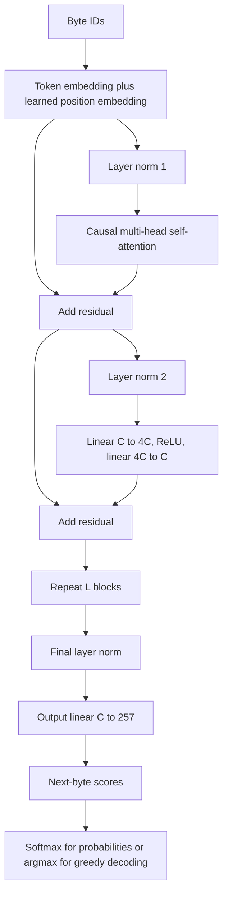

# 2. Transformer architecture and forward pass

## 2.1 Relating the requested diagram to the code

The original private reference image is omitted from the public edition. The independently written diagram below describes this implementation.

The supplied diagram contains the original encoder-decoder transformer layout, with orange highlighting intended to identify a GPT-style decoder. Its left stack is an encoder; the middle attention sublayer on the right reads encoder outputs. Our decoder-only model has no encoder and no encoder-to-decoder cross-attention. Each block instead has masked self-attention and a position-wise feed-forward sublayer.

The diagram says "Add & Norm" after sublayers. Our implementation uses **pre-normalization**: normalize the input to a sublayer, run it, then add the original residual stream. There is a final normalization before the output matrix. Learned position embeddings replace the sinusoidal position encoding drawn in the picture. These are deliberate implementation differences, so the picture is conceptual rather than an exact wiring diagram of gpt.py. The original transformer background is [Vaswani et al.](https://arxiv.org/abs/1706.03762); our executable details are established by the local code.



The curved residual routes carry numerical representations and gradients around sublayers. They are not independent critics and do not run a program to check its validity.

## 2.2 Embeddings

For input ID matrix I of shape B × T, token embeddings E have shape V × C and position embeddings P have shape S × C:

```text
X[b,t,:] = E[I[b,t],:] + P[t,:]
X.shape = (B,T,C)
```

The embedding vector is learned; there is no manually assigned coordinate meaning "loop" or "bug". Position vectors let the network distinguish order. Without position information, attention over a bag of tokens has insufficient information about sequence arrangement.

gpt.py uses Tensor.take for the lookups. A token can occur multiple times; backward must accumulate every occurrence into the same embedding row. Position embeddings use NumPy broadcasting across the batch, so their gradients sum over batch entries.

## 2.3 Layer normalization

For each token's C-dimensional row x, independently of other tokens and other examples:

```text
mu = (1/C) sum_i x_i
variance = (1/C) sum_i (x_i - mu)^2
xhat_i = (x_i - mu) / sqrt(variance + epsilon)
LN(x)_i = gamma_i * xhat_i + beta_i
epsilon = 1e-5
```

The code's Tensor.norm computes xhat. Multiplication by a learned gain gamma and addition of beta occur outside that operation. There are two gain/bias pairs per block plus one final pair. Unlike batch normalization, this computation does not need a running mean over previous batches. Layer normalization's background is [Ba et al.](https://arxiv.org/abs/1607.06450); the actual epsilon and placement above come from gpt.py.

Normalization manages the scale of sublayer inputs. It does not make all features identical: xhat retains relative component differences, and gamma/beta can learn feature-specific scales and offsets. Epsilon avoids division by zero for constant vectors.

## 2.4 Queries, keys and values

Let U = LN1(X). One combined projection computes:

```text
[Q | K | Vals] = U @ Wqkv + bqkv
Wqkv.shape = (C,3C)
bqkv.shape = (3C,)
```

The implementation reshapes B × T × 3C into B × T × 3 × H × D, then transposes to 3 × B × H × T × D. Selecting index 0, 1, 2 yields Q, K and Vals, each B × H × T × D.

Informally, queries describe what a position seeks, keys describe what a position offers for matching, and values carry what gets mixed into the result. These are learned linear projections; that language is an interpretation rather than a prescribed symbolic algorithm.

## 2.5 Scaled dot-product scores and causal masking

For head h and positions t and s:

```text
scores[b,h,t,s] = dot(Q[b,h,t,:], K[b,h,s,:]) / sqrt(D)
scores.shape = (B,H,T,T)
```

If independent components have roughly comparable variance, a dot product's variance grows with D. Scaling by sqrt(D) helps keep the score range from growing simply because the head is wider. It does not guarantee a particular score distribution after training.

The causal mask M is 0 for s <= t and -1e9 for s > t. Attention applies softmax along the source-position axis s:

```text
A = softmax(scores + M)
```

This prevents a position from reading future target tokens during teacher-forced training. For the sequence `a b c`, the first position can read a, the second can read a/b, and the third can read a/b/c. A position may read itself because it predicts the *next* token, not its own input token.

The implementation uses a large finite negative constant rather than negative infinity. After stable softmax, ordinary scores yield zero floating-point probability for these masked entries. With the small normal initialization, the intended masking is numerically effective; adversarially huge scores are not handled as a separate special case.

## 2.6 Attention mixture and output projection

```text
Z[b,h,t,:] = sum_s A[b,h,t,s] * Vals[b,h,s,:]
Z.shape = (B,H,T,D)
```

The heads are transposed to B × T × H × D and flattened into B × T × C. A learned projection mixes their outputs:

```text
attention_output = concat_heads(Z) @ Wo + bo
X1 = X + attention_output
Wo.shape = (C,C)
```

All heads attend over the sequence, but their projections differ. Head count changes how C is partitioned, not the total Q/K/V matrix sizes for fixed C. More heads therefore do not multiply parameter count in this implementation. They do affect the B × H × T × T score tensor.

## 2.7 Feed-forward sublayer

```text
U2 = LN2(X1)
F = ReLU(U2 @ Wup + bup)
X2 = X1 + F @ Wdown + bdown
Wup.shape = (C,4C)
Wdown.shape = (4C,C)
```

ReLU(a) = max(0,a). This provides a nonlinearity; otherwise successive linear transforms could collapse into a single linear transform in isolation. Unlike attention, this sublayer does not directly mix different sequence positions. Attention has already mixed their information into the vectors it receives.

The project uses ReLU for simplicity, not GELU or a gated feed-forward activation. Dropout is not present. There is no mixture-of-experts routing. These details matter when comparing our parameter counts or behavior with another "GPT" implementation.

## 2.8 Repetition and output head

The block repeats L times. Then:

```text
hidden = LNfinal(X_L)
logits = hidden @ Wout
Wout.shape = (C,V)
logits.shape = (B,T,V)
```

There is no output bias, and Wout is not tied to the token embedding E. Different positions receive a full vector of 257 logits. During training all scored positions contribute to loss in parallel. During generation only the final position's logits choose the next byte.

Softmax is inside attention and inside loss/sampling computations. Greedy generation directly takes argmax of logits: softmax preserves their ordering, so applying softmax first would not change that selection.

## 2.9 Exact parameter count

Embeddings contribute VC + SC. A block contributes:

| Arrays | Count |
|---|---:|
| QKV matrix and bias | 3C² + 3C |
| Attention output matrix and bias | C² + C |
| Feed-forward up matrix and bias | 4C² + 4C |
| Feed-forward down matrix and bias | 4C² + C |
| Two norm gains and two norm biases | 4C |
| **Per block** | **12C² + 13C** |

The final norm contributes 2C; output head contributes CV. Therefore:

```text
N = (2V + S + 2)C + L(12C² + 13C)
```

With V=257, S=384, C=128 and L=5:

```text
embedding + position + output + final norm = 900 * 128 = 115,200
one block = 12*16,384 + 13*128 = 198,272
five blocks = 991,360
total = 1,106,560
```

Other recovered configurations are 90,528 parameters for C=48/S=192/L=2, 207,552 for C=64/S=384/L=3, 17,680 for C=16/S=384/L=1 and 14,608 for C=16/S=192/L=1. These numbers count learned scalars, not Adam buffers or activations.

## 2.10 Runtime and memory

Per block the dense projections and feed-forward network cost roughly O(BTC²), while attention matrix products cost O(BT²C). Scores/probabilities use O(BHT²) storage. Backpropagation retains more arrays than inference.

A 1,106,560-element float64 weight set occupies 8,852,480 bytes, about 8.44 MiB. Weights, gradients and two Adam buffers alone use about 33.8 MiB. Temporary arrays, graph objects, attention activations, copies and BLAS workspaces increase actual process memory substantially. That lower bound is not an exact RAM estimate.

At B=2, H=4, T=384 one attention score tensor has 1,179,648 float64 entries, exactly 9 MiB. Several such arrays can coexist per layer during training. Doubling context makes these tensors four times as large. Reducing width primarily helps dense-matrix work; reducing context directly helps attention memory. This is why a longer input limit is not a free configuration change.
