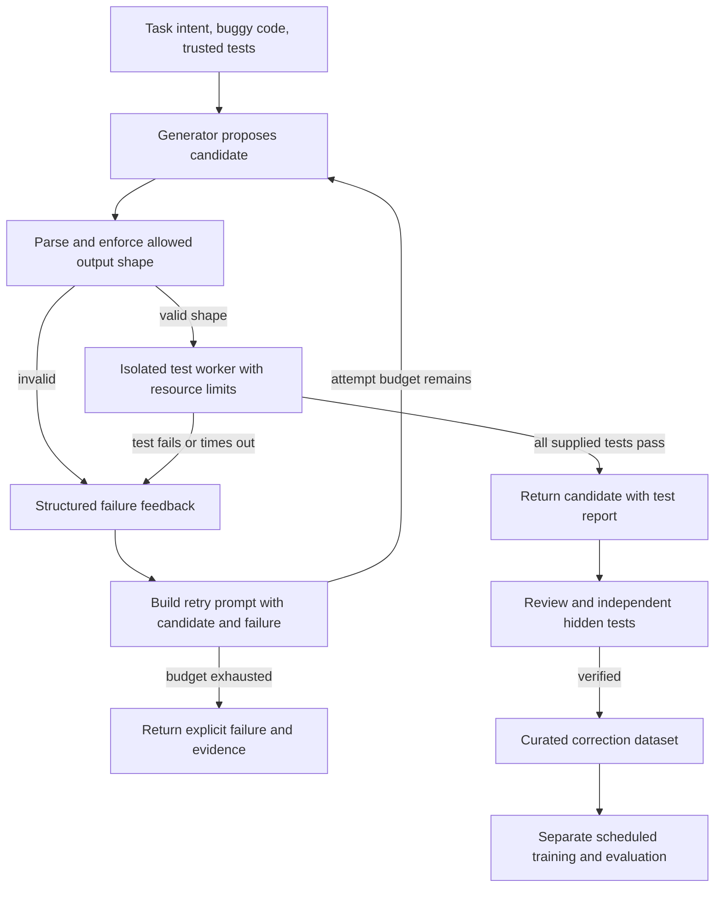

# 6. A generator and checker: the requested feedback architecture

## 6.1 Implementation status

The user proposed two units: a "brain" that solves the problem and another unit that checks the result against learned information to minimize error. The core idea is useful, but the checker must be specified carefully. The captured app generates once and checks whether the result parses as a Python function. It does not run tests, retry after errors, or update weights from interaction.

This chapter specifies a future design. It does not claim that drawing the diagram or writing these requirements has implemented that system.

## 6.2 Why a second model is not automatically an independent checker

If the same small model generates an answer and then rates its own answer, both judgments can share the same blind spots. A second model trained on the same narrow data may do the same. Agreement is not sufficient evidence of correctness. A learned critic could be useful later, but independent executable tests give more concrete feedback for code.

A valid checker needs an oracle: known expected outputs, task invariants, reference behavior, formal specifications or trusted human judgment. A model's high next-token probability is not that oracle. Python parsing is a useful first filter but cannot decide whether `a-b` should have been `a+b`.

## 6.3 Proposed end-to-end flow



A successful result should be described as "passed these tests" rather than "proved correct". The system must expose failures instead of hiding an invalid suggestion behind a success label.

## 6.4 Responsibilities and boundaries

**Generator:** receives the task and bounded context, returns a candidate function. It cannot authorize its own execution policy, overwrite tests, or claim success by printing a phrase.

**Checker/controller:** owns the test cases, output schema, retry count, resource budget and decision rule. It validates the candidate's expected function name/signature and rejects extra executable top-level content before any execution.

**Execution worker:** runs inside an actual isolation boundary with restricted filesystem/network/process capabilities, timeouts and resource quotas. The controller remains outside. Arbitrary Python can access powerful features, so a simple `exec` with a reduced builtins dictionary is not a general security solution. A subprocess with a timeout controls time but not filesystem/network access. The current source-controlled mutation checks are not an implementation of this worker.

**Training process:** consumes reviewed examples offline and updates a new checkpoint, leaving the old model available for comparison/rollback. The interactive generator should not mutate its parameters while a user is testing an answer.

## 6.5 Structured feedback format

A future retry example could contain fields like:

```text
TASK:
Return n factorial for a nonnegative integer n.
BUG:
def factorial(n): ...
ATTEMPT:
def factorial(n): ...
CHECK:
case: factorial(5)
expected: 120
observed: 24
FIX:
<new candidate>
```

Training and inference must agree on this serialization. The current model was trained on BUG/FIX only, so merely presenting this longer prompt is not enough. It would need correction trajectories containing failed attempts, trusted feedback and successful revisions. A 384-byte context is also likely too short for a useful task, code, failed attempt, traceback and new answer simultaneously.

Do not silently drop the task or critical failure when truncating. A future tokenizer/context design should measure actual prompt budget and preserve the most relevant evidence with explicit truncation notices.

## 6.6 Bounding search and retries

A retry controller should have a fixed attempt budget, wall-clock budget, maximum generated length and a deduplication set of attempted candidates. If greedy decoding produces an identical candidate from unchanged input, rerunning it wastes compute. Retry prompts must change in a meaningful way, or controlled sampling/search must explore another candidate.

For a simple toy model where each candidate independently succeeds with probability p, the chance of at least one success after k attempts is 1-(1-p)^k. Our actual candidates are correlated and p is unknown, so that equation is an illustration, not a performance prediction. Repeatedly generating nearly identical errors provides far less benefit than the independent model suggests.

Passing public tests can still lead to test overfitting. If feedback reveals every hidden case, those cases cease to be hidden. Use separate development/checker tests and final evaluation tests, and report which set influenced retries.

## 6.7 Learning permanently from a correction

When a candidate fails, no weight update is inherently required. The controller can use its error as additional input for the next attempt. That is in-context adaptation, not parameter learning.

For permanent learning, capture the original task, original code, failed candidates, exact checker output, final independently verified correction, test provenance and model version. Review the example. Assign its task family to a stable split before augmentation. Only then include it in a new training run and compare both old and new checkpoints on untouched tasks.

Training on an unchecked model answer can reinforce errors. Training on test-passing answers can also reinforce narrow hacks if tests are weak. Examples from one user may reveal private code; a future collection pipeline must keep the user's intended storage/sharing scope explicit. This repository is local and does not upload user code.

## 6.8 Reward-style training versus supervised correction

The existing system uses supervised cross-entropy. A behavioral checker could supply a reward, such as fraction of tests passed. Optimizing expected reward is conceptually different from teacher-forced next-byte training. It would require a sampling policy, credit assignment, baselines and additional stability controls.

For this project, the simpler next step is to collect verified successful corrections and feedback-conditioned trajectories, then use the existing supervised machinery with a revised prompt format. That keeps the numerical implementation inspectable and avoids presenting an unimplemented reinforcement-learning method as a small configuration switch.

## 6.9 Acceptance criteria for the checker milestone

Before calling the system a checker-and-retry debugger, demonstrate all of the following on trusted synthetic tasks: invalid output is rejected; wrong-but-valid code fails tests; nonterminating code is stopped; no test can be rewritten by the candidate; duplicate candidates do not loop forever; a failing candidate receives structured feedback; retry limits terminate; passing evidence is attached to the output; and saved corrections cannot leak into an untouched final benchmark.

Before running arbitrary generated Python, establish the actual OS/container isolation properties. Until then, retain the current app's useful boundary: display suggestions and parse them, but do not execute them.
